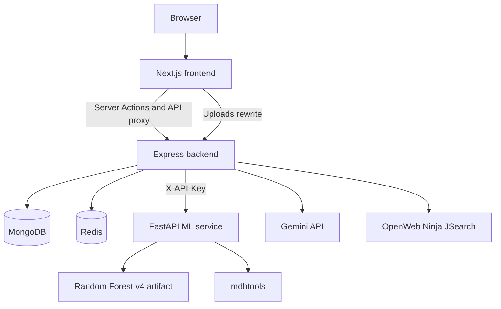
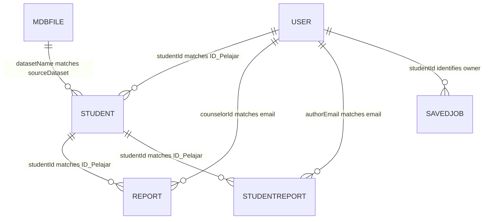
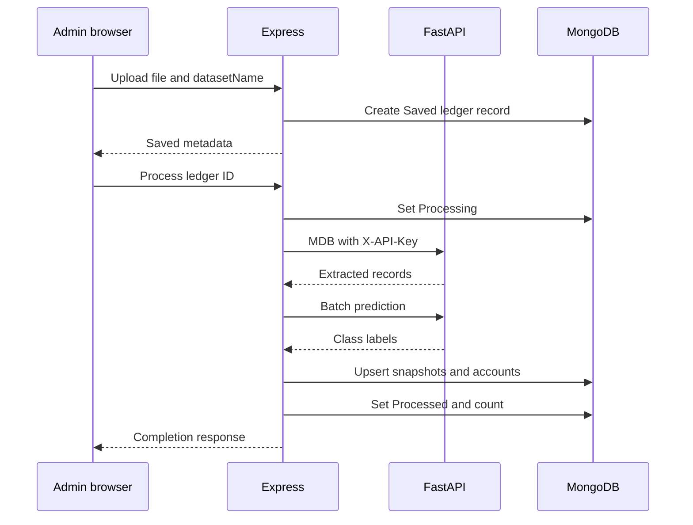

# TVETMARA Besut dashboard: project structure and system reference

Initial project review: 8 November 2026. Learning-resource implementation and verification update: 10 November 2026.

This project is a student monitoring and talent development dashboard for TVETMARA Besut, also called IKMB in the code. It brings academic records, attendance, learning outcomes, risk predictions, counseling, and career information into one application.

The browser uses a Next.js website. Next.js forwards application API requests to an Express backend. Express reads MongoDB, caches career information in Redis, calls a Python service for academic risk predictions and MDB extraction, and calls external providers for AI advice and job listings.

This document describes the implementation available in this workspace. It distinguishes working connections in the source from incomplete controls, older scripts, and claims that require runtime verification. It does not assume that a feature works because a button or a comment exists.

For a first reading, start with sections 1 and 2, then follow the browser request in section 4 and the import workflow in section 8. Sections 6 and 7 explain access and records. Use section 19 to locate the implementation of a specific feature. Sections 13 through 17 are lookup material for API work, deployment, tests, and troubleshooting.

## Contents

1. [Purpose and terminology](#1-purpose-and-terminology)
2. [Architecture and technologies](#2-architecture-and-technologies)
3. [Project layout](#3-project-layout)
4. [Frontend routes and request flow](#4-frontend-routes-and-request-flow)
5. [Staff and student workflows](#5-staff-and-student-workflows)
6. [Authentication and permissions](#6-authentication-and-permissions)
7. [Database records and response shapes](#7-database-records-and-response-shapes)
8. [Datasets and MDB processing](#8-datasets-and-mdb-processing)
9. [Risk predictions and calculated scores](#9-risk-predictions-and-calculated-scores)
10. [Career search, pathways, and bookmarks](#10-career-search-pathways-and-bookmarks)
11. [Counseling and student reports](#11-counseling-and-student-reports)
12. [Staff AI chat](#12-staff-ai-chat)
13. [API reference](#13-api-reference)
14. [Configuration and deployment](#14-configuration-and-deployment)
15. [Offline scripts and training](#15-offline-scripts-and-training)
16. [Tests and continuous integration](#16-tests-and-continuous-integration)
17. [Limitations and troubleshooting](#17-limitations-and-troubleshooting)
18. [Reading scope and maintenance](#18-reading-scope-and-maintenance)
19. [Complete file-by-file reference](#19-complete-file-by-file-reference)

## 1. Purpose and terminology

### 1.1 Users and responsibilities

| Person | Role value | Interface label | Main work |
| --- | --- | --- | --- |
| Coordinator | `admin` | Penyelaras | Reviews institute statistics, manages student records, imports datasets, uses AI advice, and monitors interventions. |
| Counselor | `counselor` | Kaunselor | Reviews students, manages pending or assigned referrals, schedules sessions, and sends reports. |
| Student | `user` | Pelajar | Views their own performance, manages certificates and a photo, reads reports and appointments, and explores careers. |

Both `admin` and `counselor` count as staff. Student management, individual profiles, student assets, numeric prediction, and chat allow both roles. MDB management and administrative password reset are restricted to admins.

### 1.2 Terms used in the source

| Term | Meaning |
| --- | --- |
| Student ID | Academic identifier stored as `Student.ID_Pelajar`. Normalized API responses call it `id`. `User.studentId` links a login to that student. |
| Dataset | Administrator-defined name for an imported MDB file, stored in `MdbFile.datasetName` and copied into `Student.sourceDataset`. |
| Snapshot | One student's academic record within one dataset. A student can have several MongoDB documents across datasets. |
| Semester | Either the student's numeric academic semester or an imported dataset called a semester in the UI. These are separate values. |
| Current semester | Processed ledger entry marked `isCurrentSemester: true`. It controls default dataset selection. |
| MDB | Microsoft Access database file. The application accepts `.mdb` uploads. |
| ETL | Extract, transform, and load. Here it means extracting MDB tables, assembling students, predicting risk, and saving records. |
| GPA | Grade point average for one semester, stored in academic history. |
| CGPA | Cumulative grade point average. Display formulas use 4.00 as the denominator. |
| PLO | Program Learning Outcome. The application uses nine percentage scores, `PLO_1` through `PLO_9`. |
| CLO | Course Learning Outcome. Some internal assessment LO numbers must not be treated as program PLOs. |
| Referral | `Report` record for counseling or intervention, with a reason, counselor, date, and status. |
| Student report | `StudentReport` message or letter addressed to a student, with a title and read flag. |
| Career history | Up to ten daily search keywords shared by a department in Redis. |
| Saved job | A student's persistent job bookmark in MongoDB. It survives the daily cache reset. |

The route name `reports` means referrals. The route name `student-reports` means inbox messages and letters. This distinction matters throughout the dashboard.

### 1.3 Different meanings behind AI-labelled displays

The project combines several methods:

- A trained Random Forest predicts academic risk in Python.
- Backend JavaScript rules normalize risk labels and provide prediction fallbacks.
- Arithmetic formulas calculate employability, top-performer display scores, and career readiness.
- Fixed dictionaries select some example careers and certifications.
- A local learning catalog supplies current-course recommendations with explicit assessment and curriculum-review rules.
- Gemini generates staff advice using a supplied student context.
- JSearch supplies external job advertisements.

These outputs have different meanings. A fixed `95% Match` career example is not a model-generated probability. The employability percentage is a formula, not observed employment success.

## 2. Architecture and technologies

### 2.1 Service boundaries



`compose.yml` defines five services, including three application services and two data services:

| Service | Responsibility | Internal address | Published host port |
| --- | --- | --- | --- |
| `frontend` | Next.js pages, Server Actions, page guards, and browser API proxy | `frontend:3000` | `8080:3000` |
| `backend` | Application API, authorization, uploads, database writes, and provider calls | `backend:5000` | `5000:5000` |
| `ml-api` | Academic risk inference and MDB extraction | `ml-api:8000` | `8000:8000` |
| `mongodb` | Persistent application records | `mongodb:27017` | None |
| `redis` | Temporary career data, request locks, and provider cooldown | `redis:6379` | None |

All five services join the `tvet_net` bridge network. Service hostnames are for communication inside that network. A browser or host-based Node process normally needs a host-reachable address instead.

The frontend owns presentation, local state, navigation, and session cookies. It does not query MongoDB. Express owns application rules and persistence. FastAPI returns extracted records and predictions to Express and has no MongoDB connection.

MongoDB stores durable application records. Redis owns temporary career information and coordination records. Saved jobs are durable MongoDB records, independent of Redis expiry.

### 2.2 Technologies and resolved versions

These values come from this checkout's manifests and lockfiles. They are not an inspection of an independently running deployment.

| Area | Technology | Manifest requirement | Resolved version |
| --- | --- | --- | --- |
| Frontend | Next.js | `15.1.6` | `15.1.6` |
| UI | React and React DOM | `^19.0.0` | `19.2.8` |
| Charts | Chart.js | `^4.5.1` | `4.5.1` |
| Chart binding | react-chartjs-2 | `^5.3.1` | `5.3.1` |
| Frontend JWT | jose | `^6.2.12` | `6.2.12` |
| Backend | Express | `^5.2.1` | `5.2.1` |
| Database models | Mongoose | `^9.3.3` | `9.7.4` |
| Password hashing | bcryptjs | `^3.0.3` | `3.0.3` |
| Backend JWT | jsonwebtoken | `^9.0.3` | `9.0.3` |
| Uploads | multer | `^2.2.0` | `2.2.0` |
| Redis client | redis | `^5.12.1` | `5.12.1` |
| Frontend tests | Vitest | `^4.1.10` | `4.1.11` |
| DOM test environment | jsdom | `^29.1.1` | `29.1.1` |

Styling uses Tailwind CSS 3 with PostCSS and Autoprefixer. Backend tests use Jest and Supertest. FastAPI, Uvicorn, scikit-learn, joblib, pandas, NumPy, Pydantic, and the Python test dependencies are unpinned in `ML/requirements.txt`. There is no Python lockfile.

Both Node packages use ECMAScript modules through `"type": "module"`. Application source is JavaScript and JSX. No TypeScript source files are present.

The containers use `node:20-alpine`. Several locked dependencies require Node 20.19 or later, including Mongoose and jsdom. An older Node 20 installation does not satisfy those requirements. The ML container and CI job use Python 3.11.

## 3. Project layout

```text
.
├── .github/workflows/       GitHub Actions workflow
├── ML/                     FastAPI, saved models, training, and ML tests
├── backend/
│   ├── __tests__/          HTTP tests
│   ├── db/                 Offline MDB and training-data scripts
│   ├── middleware/         JWT, role, and ownership checks
│   ├── models/             MongoDB schemas
│   ├── services/           Redis cache and external job-provider adapter
│   ├── uploads/
│   │   ├── certificates/   Certificate files and profile photos
│   │   ├── mdb/            Saved Access database files
│   │   ├── referrals/      Counseling attachments
│   │   └── reports/        Student-report PDFs
│   └── utils/              Career validation, keys, and pathway rules
├── docs/                   Additional career-cache documentation
├── mongodb_data/           MongoDB data volume, not source code
├── public/                 Browser-accessible static assets
├── scripts/                Repository checks
└── src/
    ├── __tests__/          Frontend tests
    ├── app/                Next.js routes, actions, layout, and styles
    ├── assets/             Retained source assets
    ├── components/
    │   ├── auth/           Login and password forms
    │   ├── dashboard/      Staff, student, counseling, and inbox screens
    │   └── ui/             Shared display components
    └── lib/                Cookie readers, role labels, formulas, and previews
```

Section 19 describes every available project file individually. The workspace also has empty `.git`, `.agents`, `.codex`, and `.aws` directories supplied by the environment. No `AGENTS.md` was available.

No `dist`, `.next`, installed `node_modules`, original MDB inputs, training CSV, or extracted training-data directory was present during this review. The four upload subdirectories were empty. Paths referenced by scripts do not necessarily identify files included in this checkout.

## 4. Frontend routes and request flow

### 4.1 Actual page routes

| Route | Client component | Access and purpose |
| --- | --- | --- |
| `/` | `LoginForm` | Login. Authenticated visitors are redirected by role or password-change requirement. |
| `/change-password` | `ChangePasswordForm` | Any authenticated role. Required when the account is flagged. |
| `/staff-dashboard` | `StaffDashboardClient` | Admin and counselor application. |
| `/student-dashboard` | `StudentDashboardClient` | Student application. Staff are redirected to their dashboard. |
| `/student-profile?id=...` | `StudentProfileClient` | Staff view of one student. `dataset` pins a snapshot and `from` records the originating tab. |
| `/api/*` | Catch-all route handler | Forwards supported methods to Express, which enforces API permissions. |

Middleware recognizes `/login` as a login-like path, but there is no `src/app/login/page.jsx`. The implemented login page is `/`.

All five page components export `dynamic = 'force-dynamic'`. They are small wrappers around interactive client components. Dashboard records load through client-side effects after mount. Dynamic rendering does not mean every dashboard section fetches MongoDB data server-side.

### 4.2 One API request from browser to database

For `GET /api/students?dataset=JJ2026`, the request flow is:

1. A dashboard calls same-origin `fetch`.
2. `src/app/api/[...proxy]/route.js` joins the catch-all path and retains the query string.
3. The proxy reads the HttpOnly `ikmbToken` cookie on the server.
4. When that cookie exists, the proxy sets `Authorization: Bearer <token>` upstream.
5. Express verifies the token and checks the account's current password state.
6. The route applies dataset, role, and ownership restrictions.
7. Mongoose queries MongoDB.
8. `normaliseStudent` converts database field names and numeric strings to the browser shape.
9. The proxy returns the response, and the component stores it in React state.

The proxy supports GET, POST, PUT, PATCH, and DELETE. It removes `host`, `connection`, and `content-length` request headers, forwards non-GET bodies as a blob, and streams upstream responses. It removes the upstream `transfer-encoding` header. Connection failure returns JSON with a 500 status.

Some components still send `Bearer proxy-handled`, returned by `getClientToken`. This placeholder is not a credential. A real cookie lets the proxy overwrite it. Express rejects the placeholder if no valid token replaces it.

### 4.3 State and persistence

There is no Redux, Zustand, or React Query store. Components use React state, effects, memoized values, and refs.

| State | Where it lives |
| --- | --- |
| Display identity | Readable `user` cookie and component state. |
| Session credential | HttpOnly `ikmbToken` cookie. |
| Staff tab and dataset | React state plus `tab` and `dataset` URL parameters, restored on initialization. |
| Profile navigation | `id`, `dataset`, and `from` URL parameters. |
| Student tab | React state, initially `dashboard` on a new mount. |
| Counseling filters and modals | State inside the counselor component. |
| Chat transcript | Temporary `aiMessages` array in staff state. |
| Career forms and pages | State inside the student component. |
| Department job results and history | Redis until the daily reset. |
| Saved bookmarks | MongoDB, then loaded into browser state. |
| File previews | Temporary object URLs, revoked on replacement or unmount by the preview hook. |

The source does not use `localStorage` or `sessionStorage`. Staff URL parameters preserve context on refresh and profile navigation. There is no general URL-to-state synchronization layer for every browser Back or Forward event.

### 4.4 Styling, charts, and responsive behavior

The layout sets `lang="ms"`, loads Plus Jakarta Sans through `next/font/google`, and loads the Phosphor web icon script from unpkg. Tailwind classes provide most styles.

`globals.css` defines `fadeIn`, `slideInLeft`, `slideInRight`, `slideUp`, `scaleIn`, `floatSoft`, and `shimmer`. Utilities include stagger delays, animation fill mode, loading shimmer, 44-pixel touch targets, responsive text, smooth scrolling, and safe-area padding.

The staff overview has a PLO bar chart. The student dashboard has a PLO radar chart. The staff profile combines GPA lines and attendance bars on separate axes and also has a PLO radar chart. These use Chart.js through React bindings.

The sidebar becomes a sliding overlay on small screens, with Escape close and body-scroll lock. Most modals fill mobile screens and become centered sheets on larger screens. The calendar switches between a mobile bottom sheet and desktop side panel at a 1024-pixel width.

## 5. Staff and student workflows

### 5.1 Staff startup and dataset selection

`StaffDashboardClient` reads the display cookie and requests processed datasets from `/api/semesters`. It chooses:

1. A URL dataset that matches an available processed entry.
2. A processed entry marked current.
3. The first entry in the processed-date-descending response.

Without a processed dataset, it displays an empty student list. Admins also load the complete MDB archive. Changing the dataset fetches students again. The component writes its active tab and dataset to the URL.

### 5.2 Staff tabs

| Tab ID | Interface label | Behavior |
| --- | --- | --- |
| `overview` | Dashboard Overview | Student count, average employability, high-risk count, institute PLO averages against 80%, five high-risk rows, and five top CGPA students. |
| `prediction` | AI Prediction | Student selector, context card, quick prompts, and Gemini conversation. This is primarily the advisor chat interface. |
| `skills` | Skills Gap Analysis | Institute PLO averages, gaps to 80%, and status labels. |
| `pathways` | Learning Pathways | Fixed training suggestions for PLO shortfalls, largest gap first. |
| `management` | Student Management | Student card search and filters, profile navigation, and create-student form. |
| `counselor` | Kaunseling & Intervensi | Counseling calendar, status queues, scheduling, completion notes, and sent student reports. |
| `data` | Pengurusan Data | MDB upload, process, delete, and set-current-semester operations. Admin only. |

Counselors receive all tabs except `data`. Express also restricts MDB operations independently of the UI.

Top performers are selected by descending CGPA. The separate percentage displayed beside them uses the top-performer formula. That percentage does not determine their rank.

The management grid has its own name and ID search. The staff header also has a search field, but its derived `filteredStudents` value is not passed to the rendered management grid. That grid receives the unfiltered `students` array and applies its own filters.

### 5.3 Staff student profile

Profile links carry student ID, active dataset, and the originating staff tab. The profile requests the selected snapshot's skill-gap endpoint and displays personal information, history, PLO analysis, risk, and calculated employability.

Its three tabs are `personal`, `academic`, and `skills`. Staff can open counseling, academic-clinic, or soft-skills referrals and compose a student report or letter.

The back action restores the tab and dataset. Print calls `window.print`. Download creates a JSON file containing student details, history, insight, employability, and PLO scores. It is not a PDF export.

The profile's **Edit** button has no handler. The staff component contains edit and delete functions, and the API supports those actions, but the visible card-to-profile flow does not connect them to working edit or delete controls.

### 5.4 Student dashboard

The student dashboard selects the current or latest processed dataset. It requests the authorized student list, then skill-gap data and certificates. A normal student account receives only its linked student record from Express.

| Tab ID | Interface label | Behavior |
| --- | --- | --- |
| `dashboard` | Profil & Prestasi | Risk, dataset, employability, attendance, CGPA, PLO radar, weakest-PLO message, and example careers. |
| `profile` | Kemaskini Sijil Saya | Photo and certificate uploads and certificate removal. Identity fields are disabled. |
| `reports` | Laporan & Temujanji | Messages, letters, and accepted or scheduled referrals. |
| `career` | Padanan Kerjaya (AI) | Fixed examples, provider search, pathways, descriptions, and saved jobs. |
| `courses` | Kursus Cadangan | Authenticated current-course learning modules, provider portals and reading resources, with reasons and real external links. |

The student screen shows its active dataset but does not render a semester selector. Student tabs are not persisted in the URL.

An unlinked demo user has `studentId: null`, so the backend returns no student records for it. It demonstrates authentication rather than a real profile.

The learning tab opens real provider pages through **Mula Belajar**, **Baca e-buku** or **Buka portal pembelajaran**. Enrollment and learning stay on the provider site; the dashboard does not book sessions or claim completion. The old inactive **Daftar Sesi** control has been removed.

## 6. Authentication and permissions

### 6.1 Login, cookies, and token claims

`loginAction` sends email and password to Express. `authenticateUser` trims and lowercases the email, looks up the account, checks lockout state, and compares its bcrypt hash.

Express returns a sanitized user, access token, forced-change flag, and previous login time. The Server Action writes:

| Cookie | Content | JavaScript access | Settings |
| --- | --- | --- | --- |
| `user` | Email, role, display name, and linked student ID as JSON | Readable | Path `/`, 24-hour max age, Secure in production. |
| `ikmbToken` | Signed JWT | HttpOnly | Path `/`, 24-hour max age, SameSite Lax, Secure in production. |

The JWT lasts eight hours, shorter than its cookie. A cookie can remain after its token expires. The readable profile cookie supports presentation. It is not the authority for backend access.

The token contains `email`, `role`, `studentId`, `mcp`, and `pwdAt`. `mcp` means must change password. `pwdAt` represents the last password change in whole epoch seconds, or zero.

The backend signs HS256 tokens and explicitly verifies that algorithm, issuer, and audience. Defaults are `tvetmara-backend` and `tvetmara-dashboard`. Next.js middleware checks signature, issuer, and audience with `jose`; its call does not explicitly set an `algorithms` option.

### 6.2 Enforcement layers

1. Next.js middleware redirects anonymous visitors, separates staff and student pages, and applies the password-change page gate.
2. The API proxy forwards the cookie credential. It does not implement resource ownership itself.
3. Express `verifyToken` checks the token and reads current account password state from MongoDB.
4. Role middleware and route handlers check staff access, student ownership, counselor assignment, authorship, or department membership.

Express rejects missing accounts, recovery tokens, and access tokens whose `pwdAt` predates the stored password-change second. Its account lookup reloads password state, not the current role or student link. Those values remain signed claims until a new token is issued.

`requireOwnershipOrAdmin` allows either staff role or the matching student. Its name does not mean counselors are excluded.

### 6.3 Password changes, lockout, and logout

Flagged accounts can log in but receive 403 with `code: "PASSWORD_CHANGE_REQUIRED"` on protected routes outside the login and change-password path whitelist. The backend flag is authoritative. Page redirects are the UX layer.

Password policy requires at least eight characters, at least one letter, and at least one digit. Symbols are suggested in the UI but not required by policy. The new password cannot match the old password.

A successful change writes a bcrypt hash with cost 10, clears the forced-change and lockout state, records a change timestamp, and returns a fresh access token. The Server Action rotates both cookies.

Five failed password comparisons set a 15-minute lock. Requests during the lock return 423. Successful login resets the failure count. Merely passing the lock deadline does not reset the accumulated count in the source.

Logout deletes browser cookies. There is no server-side revocation list. A separately retained access token is still governed by expiry, account existence, and password-change checks.

### 6.4 Recovery and administrative reset

Student recovery is a two-step browser flow without email:

1. `/api/auth/forgot-password` matches `idPelajar` and digit-normalized `noKP` against a Student record and the corresponding `<ID>@student.ikmb.edu.my` account.
2. `/api/auth/complete-password-reset` validates the returned token and new password, then updates the account.

The recovery token lasts 15 minutes, uses audience `tvetmara-password-reset`, and has `scope: "password-reset"`. It cannot authenticate normal API calls. The modal keeps it in component state.

Both recovery requests share a limiter of eight requests per 15 minutes, keyed by the final portion of the token or student ID. Reuse prevention binds the token to the password-change timestamp in whole seconds. There is no stored one-time token ID or atomic consume operation, so strict simultaneous single-use behavior is not established.

Admins can reset an account with `/api/auth/reset-password`. The response returns a generated temporary password, and the account must change it afterward. The current frontend has no admin reset form.

MDB-created accounts get a random initial password that is not returned by the import. A separate recovery or reset step is needed to establish access. Seed-script demonstration accounts follow different initial-password behavior.

### 6.5 Permission matrix

All protected operations also require an existing account, valid access token, and completion of any forced password change.

| Operation | Admin | Counselor | Student |
| --- | --- | --- | --- |
| Read processed datasets | Allowed | Allowed | Allowed |
| Read student list | Selected dataset | Selected dataset | Own linked ID only |
| Read student or skill gap | Allowed | Allowed | Own linked ID only |
| Create, update, delete student | Allowed | Allowed | Denied |
| Manage photo or certificates | Allowed | Allowed | Own linked ID only |
| Manual prediction and AI chat | Allowed | Allowed | Denied |
| MDB administration | Allowed | Denied | Denied |
| Read user roster | Allowed | Allowed | Denied |
| Administrative password reset | Allowed | Denied | Denied |
| Create referral | Allowed | Allowed | Denied |
| List or modify referrals | All | Pending or assigned | Denied |
| Read `/reports/mine` | Linked-ID behavior, usually empty | Linked-ID behavior, usually empty | Own accepted or scheduled records |
| Create student report | Allowed | Allowed | Denied |
| List student reports | All | Authored reports | Own addressed reports |
| Read one student report | All | Author or matching student link | Matching student link |
| Delete student report | All | Author only | Denied |
| Career search, history, details | Authorized selected scope | Authorized selected scope | Own database-derived department |
| Read pathway | Allowed | Allowed | Own linked ID |
| Save or remove job bookmark | Denied | Denied | Own linked account only |

## 7. Database records and response shapes

### 7.1 Logical relationships



These are logical relationships through strings, not enforced foreign keys or Mongoose `ref` relationships. Staff normally have no student link. Several Student documents may represent one ID across datasets.

### 7.2 User model

`User` stores required unique email, required password hash, role enum, display name, and optional student link. Password state includes `mustChangePassword`, `passwordChangedAt`, `lastLoginAt`, `loginAttempts`, and `lockUntil`.

The public user shape includes email, role, display name, and student ID. The staff roster strips passwords before returning records.

### 7.3 Student model

| Fields | Type | Meaning |
| --- | --- | --- |
| `ID_Pelajar`, `Nama`, `Kursus` | String | ID, name, course code. |
| `Semester` | Number | Academic semester number. |
| `CGPA`, `Kehadiran_Pct` | String | Imported academic and attendance values. |
| `Sijil_Profesional` | String | One certification category, separate from uploaded files. |
| `PLO_1` through `PLO_9` | String | Learning-outcome scores. |
| `Status_Pelajar` | String | Stored class label or `Pending AI`. |
| `No_KP`, `No_Telefon`, `Alamat` | String | Personal information, default empty strings. |
| `academicHistory` | Embedded array | Numeric semester plus GPA, CGPA, and attendance strings. |
| `uploadedCertificates` | Embedded array | Name, issuer, filename, path, upload date, and Mongoose embedded IDs. |
| `sourceDataset` | Indexed string | Dataset name, default `unknown`. |
| `profileImage` | String | Public upload path. |

Imports upsert by `(ID_Pelajar, sourceDataset)`. The schema does not declare a unique compound index on those fields. Duplicate prevention is therefore an application convention rather than a database guarantee.

The ETL and normalizer use `Anugerah` and `Koko_Lulus`, but the Student schema does not declare those fields. New writes through that strict schema do not establish persistence for these flags.

### 7.4 Normalized student response

`normaliseStudent` converts stored fields to the browser representation:

| Stored fields | API fields |
| --- | --- |
| `ID_Pelajar`, `Nama`, `Kursus`, `Semester` | `id`, `nama`, `kursus`, `semester` |
| `CGPA`, `Kehadiran_Pct` | Numeric `cgpa`, `attendance` |
| `PLO_1` through `PLO_9` | Numeric `plo1` through `plo9` |
| `Sijil_Profesional` | `certification`, `certificationScore` |
| `Status_Pelajar` and thresholds | Derived `dropoutRisk` |
| `No_KP`, `No_Telefon`, `Alamat` | `noKP`, `noTelefon`, `alamat` |
| Award and co-curricular flags | `anugerah`, `kokoLulus`, default false |
| History, assets, dataset | Numeric history, `uploadedCertificates`, `profileImage`, `sourceDataset` |

Defaults include `Pelajar IKMB` for missing name, `Umum` for course, semester 1, and zero for unparseable numeric values. The response adds `careerStatus: "Pelajar"`.

Certification scores are `Tiada: 35`, `CompTIA: 70`, `Cisco CCNA: 85`, and `AWS Cloud: 90`. Unknown categories receive 50.

Read routes return normalized students. Create and update return Mongoose records with stored field names. Callers must not assume every student endpoint returns the same shape.

### 7.5 Other models

| Model | Fields and behavior |
| --- | --- |
| `MdbFile` | Dataset name, original name, disk path, bytes, status, processed count, upload and processed dates, and current-semester flag. Status enum is `Saved`, `Processing`, `Processed`, `Failed`. Dataset names are not unique. |
| `Report` | Student summary, intervention enum, reason, priority enum, status enum, creator email, assigned counselor email, notes, date, attachment metadata, and timestamps. |
| `StudentReport` | Student summary, semester, PLO label-value pairs, employability, author email-role-name, title, text, attachment metadata, report type, read flag, and timestamps. |
| `SavedJob` | Student ID, job ID, title, company, location, application link, salary text, posting date text, source, and save timestamp. |

Saved jobs have a unique index on `(studentId, jobId)` and an ordering index on `(studentId, savedAt descending)`.

Reports copy academic values when created. They do not automatically refresh when student records change. Neither report schema records a distinct `sourceDataset` relationship. Saved job snapshots likewise do not prove a vacancy remains open.

## 8. Datasets and MDB processing

### 8.1 Read selection

Without an explicit dataset, backend student reads choose a processed current ledger record, then the most recently processed one. Without either, lists return empty arrays and single lookups return null.

Explicit dataset reads stay within that dataset. An unpinned `getStudentById` can fall back to the student's newest `_id` snapshot after resolving a default dataset. It does not generally ignore explicit dataset selection.

The student-list route has an extra owner fallback: if the requested snapshot is absent, it retries without an explicit dataset. Later detail calls still pass the client's active dataset, so list and detail behavior can disagree for a missing snapshot.

Setting the current semester clears all flags and then saves one selected processed file. These are separate updates, not a transaction or uniqueness constraint.

### 8.2 Upload and process sequence

Uploading saves the binary file and a `Saved` ledger entry. It does not import students. Processing is a separate request.



The process request checks file existence and `Processing` state, then waits for completion. There is no external worker queue. The admin polls the ledger every three seconds while processing activity is visible.

### 8.3 Live extraction in FastAPI

The ML route validates the `.mdb` filename and 100 MiB limit, creates a temporary file, extracts data, and removes that temporary file afterward.

| MDB table | Use |
| --- | --- |
| `GPA` | Establishes the student set, latest semester and CGPA, and semester GPA-CGPA history. |
| `Pelajar` | Names, course codes, No. KP, phone, and combined address. Course-code asterisks are removed. |
| `Daftar_Subjek` | Overall attendance and attendance grouped by student and semester. |
| `Detail_Result` | PLO marks parsed from `LO<number>` in `Kod_Ujian`. |
| `Anugerah` | Award flag. |
| `Pelajar_Koko_Detail` | Co-curricular pass flag when `Result` is `LULUS`. |

Overall attendance includes available numeric zeros. History attendance uses values above zero. These views can differ.

For PLO extraction, any subject with an LO number greater than nine is excluded from program PLO aggregation. Remaining LO1 through LO9 marks are averaged and rounded to whole-number strings. Missing PLOs become `"0"`.

`mdb-tables` has a 15-second timeout and `mdb-export` a 30-second timeout. Individual table failures return empty lists. A partially populated or empty extraction can therefore occur without a fatal endpoint error.

The inspection helper logs table headers and sample data, which can contain student information. It is not a no-data logging implementation.

### 8.4 Synchronization and account creation

Express requests batch predictions for extracted students. Matching returned labels replace `Status_Pelajar`. Prediction failure is tolerated, so the import can complete with `Pending AI` values.

Existing assets are gathered in `_id` ascending order. For each ID, the code selects the first nonempty photo and first nonempty certificate array. It does not merge conflicting arrays or necessarily choose the newest assets.

Student upserts use `{ ID_Pelajar, sourceDataset }`, update academic fields, and copy selected assets. They leave unrelated students and other datasets intact. Reprocessing does not remove rows absent from the new file.

Account upserts use `<ID_Pelajar>@student.ikmb.edu.my`. They refresh role, display name, and student link. A password and `mustChangePassword: true` are inserted only for a new account. Existing passwords are retained.

New MDB accounts get a random base64url password derived from 16 random bytes, hashed with bcrypt. It is not returned in the processing response.

### 8.5 Deletion, partial failure, and recovery

A failed processing operation sets the ledger to `Failed`. On startup, after MongoDB connects, the backend resets leftover `Processing` entries to `Saved`. It does not roll back partial student or account writes.

The UI prevents ordinary overlapping processing actions, and the endpoint checks status, but there is no atomic distributed import claim. Concurrent upserts are also not backed by a unique student-dataset index.

Deleting an MDB archive removes its file where the containment check permits and deletes the ledger record. It keeps imported students. Those snapshots may stop appearing in the semester selector because their ledger entry is gone.

Deleting a student removes every snapshot and linked student login accounts. It does not cascade through referrals, student reports, saved jobs, or all physical uploads.

## 9. Risk predictions and calculated scores

### 9.1 Active model and features

FastAPI loads relative path `model_ai_risiko_lengkap_v4.pkl` with joblib at import time. A failure leaves the model unavailable while the app can still serve its root running message. There is no environment override for `MODEL_PATH` or automatic v3 fallback.

The artifact metadata identifies a Random Forest classifier. The API returns a class, not a confidence score or calibrated probability.

`StudentFeatures` requires CGPA, Attendance, nine PLO floats, and a Sijil string. It has no explicit 0-to-100 or 0-to-4 bounds. The actual model input consists of thirteen numeric columns:

```text
CGPA
Avg_Subjek_Attendance
PLO_1 through PLO_9
PLO_Avg
PLO_Variance
```

Attendance is renamed for the model. The service computes PLO mean and variance and orders columns using `feature_names_in_` where available. `Sijil` is required by the request schema but is not used in the model DataFrame.

### 9.2 Stored label normalization

| Stored label | Initial display risk |
| --- | --- |
| `Bermasalah` | `Tinggi` |
| `Sederhana` | `Sederhana` |
| `Cemerlang` | `Rendah` |
| `Pending AI` | `Pending` |
| Other | `Sederhana` |

The normalizer then applies these rules in order:

1. Attendance below 80 or CGPA below 2.0 gives high risk.
2. Stored `Bermasalah` remains high risk.
3. CGPA of at least 3.5 or stored `Cemerlang` gives low risk.
4. Otherwise, the mapped value remains.

### 9.3 Live skill-gap behavior

The skill-gap operation reads a student and calls the ML single prediction again. It replaces the response's risk without saving that result to MongoDB. On failure, it falls back to high risk for attendance below 80 or CGPA below 2.0, low risk for CGPA at least 3.5, and medium otherwise.

Its response has `student`, `chart.labels`, `chart.current`, `chart.target`, and `insight`. Targets are nine values of 80. The insight chooses the lowest PLO and returns a templated JavaScript message. Zero produces a missing-assessment message. This text is not generated by Gemini.

The live path does not reapply every stored-label normalization rule after replacing risk. List and profile badges can therefore differ.

### 9.4 Formulas and interpretation

| Score | Formula | Use |
| --- | --- | --- |
| Employability | `min(100, round((CGPA / 4) * 40 + attendance * 0.6))` | Student dashboard, staff average, profile, and report summary. |
| Top-performer display | `min(100, round((CGPA / 4) * 60 + attendance * 0.4))` | Percentage beside the top five students chosen by CGPA. |
| Career readiness | `round(meanOfNinePLOs * 0.4 + (CGPA / 4) * 30 + attendance * 0.3)` | Backend pathway, after input clamping. |

CGPA 3.00 and attendance 90 produce employability 84 and top-performer display 81. With a nine-PLO average of 70, pathway readiness rounds to 78. These are calculated indices, not probabilities of employment.

Institute PLO averages include zero values. Gap is `max(80 - average, 0)`. At least 80 is `Selamat`, 60 through 79 is `Perlu Peningkatan`, and below 60 is `Kritikal`.

### 9.5 Training target labels

The training-data scripts generate labels from rules, not independently supplied dropout outcomes. A record is `Bermasalah` when any of the following holds:

- Recorded CGPA is below 3.00.
- A weighted score is below 70.
- At least one subject failed or was dropped.
- Attendance is below 80.

The weighted score gives 50% to an academic score, 25% to attendance, and 25% to the average of positive PLOs. It subtracts five points per failed subject and three per dropped subject.

A remaining record is `Cemerlang` when recorded CGPA is at least 3.90, attendance at least 80, and every positive recorded PLO is at least 80. Other records are `Sederhana`.

These rules differ from display thresholds. Failed and dropped counts help create targets but are not direct columns in the thirteen-feature inference input.

## 10. Career search, pathways, and bookmarks

### 10.1 Student career views

| View | Data source | Meaning |
| --- | --- | --- |
| Cadangan Automatik | Current-course Redis results and backend rules | Ranks saved results for the student's own selected career and workplace. Explains relevance without match percentages. |
| Carian Manual | Express, Redis, JSearch | External listings based on keyword, location, employment type, and date filter. |
| Laluan Pembelajaran | Backend rules and optional cached search | Readiness, action plan, certifications, and related listings. |
| Disimpan | MongoDB | Persistent saved job-card snapshots. |

Automatic cards are real saved-result snapshots. Opening recommendations does not call the job provider. An explicit starter-search button opens a real manual search. The dashboard overview still contains older fixed career examples; their named companies do not establish current vacancies.

### 10.2 Scope and request normalization

Allowed department codes are ITW, DFK, DGA, SLR, DCG, SED, and PPU. Students derive their department from MongoDB `Student.Kursus`, selected by the JWT student ID. The backend removes asterisks and normalizes whitespace and case. A query cannot grant another department.

Staff select either one department or one student ID. Supplying both receives an error. Details also require valid scope before accessing a globally cached description.

Career lookups use `getCurrentCareerSubject`. It requires a student row in the current processed dataset, or the latest processed dataset when none is marked current. A missing row receives `MEMBERSHIP_UNAVAILABLE`; it never authorizes an older course through the academic snapshot fallback. Academic routes retain their existing fallback separately. Historical dashboard selection cannot grant career access to a previous course. The UI rejects a different-course response.

The student-only recommendation route accepts `roleFamilyId`, `placeId` and `placeMode`. Choices are supplied by the server and belong to the current student, not a peer or manual-search default. Location is preferred unless explicitly required. A known required-location conflict excludes the result; an unknown location requires review. Ordering is selected role, positive preferred-place match, posting recency, then stable title, company and ID. Ambiguous titles enter review and known postings over 30 days old enter an older-ad section. Employer requirements remain unconfirmed because stored cards lack structured skills, experience, employment type and qualification conditions. CGPA, PLO and search popularity do not rank jobs. DGA and DCG remain explicitly unmapped for automatic ranking until their role rules are reviewed.

| Input | Rule or default |
| --- | --- |
| `q`, `location` | Become a normalized query such as `welder in malaysia`. |
| `query` | Direct effective query, incompatible with `q` or `location`. |
| `country` | Two letters, default `my`. |
| `employmentType` or `employment_types` | Default `INTERN`. Also accepts FULLTIME, CONTRACTOR, PARTTIME. |
| `date_posted` | `all`, `today`, `3days`, `week`, or `month`. |
| `num_pages` | Only string `1`. |
| `work_from_home` | String `true` or `false`, default false. |
| `cursor` | Opaque cursor preserved without lowercasing. |
| Other supported provider inputs | Language, job requirements, radius, excluded publishers, and field projection. |

Unknown parameters, conflicting aliases, invalid enums, and repeated scalar values represented as non-strings are rejected. Lists are deduplicated and sorted. Field projections retain job ID, title, and application link.

The canonical effective object is both the provider request and cache-hash input. Scope selectors and credentials are not provider search parameters.

### 10.3 Provider adapter

The adapter calls configured URLs under `https://api.openwebninja.com/jsearch/`, using `search-v2` and `job-details`. It sends `JSEARCH_API_KEY` in `x-api-key` and times out after ten seconds.

Jobs normalize to `jobId`, title, company, location, application link, salary text, posting time text, and source. Entries without ID, title, or valid HTTP or HTTPS application links are omitted. The full normalized page is kept, with duplicate IDs removed.

Missing keys, malformed responses, timeouts, and provider errors remain errors rather than successful empty pages. No automatic provider retry loop exists.

### 10.4 Redis ownership and expiry

| Redis key | Content |
| --- | --- |
| `job_cache:v3:<department>:<hash>` | Versioned search page with original effective parameters, Redis fetch time, course, reset deadline, jobs and cursor. |
| `job_history:v3:<department>` | Up to ten unique recent manual keywords. Legacy lists are excluded and expire normally. |
| `job_pages:v3:<department>` | References to the latest 30 fetched pages for bounded recommendation reads. Shares the daily deadline. |
| `job_details:<job_id>` | Shared normalized description, after access checks. |
| `job_lock:<cache-key>` | Short-lived request owner token. |
| `job_failure:<cache-key>` | Short-lived failure shared with waiters. |
| `jsearch:cooldown` | Global provider rate-limit cooldown. |

Search, details, candidate indexes and history expire at next 08:00 Malaysia, which is midnight UTC. Redis time and absolute deadlines control publication and expiry. Logical unavailability at the deadline does not promise physical byte erasure at that instant. Legacy result pages are not imported into the new namespace. Cache hits do not extend freshness or promote pages in the index. The personalized response is never cached under a course-only key.

Lua scripts atomically check and claim a miss. An owner receives a random token and 30-second lock. Waiters wait up to twelve seconds rather than independently calling the provider. Publication checks ownership and the original daily boundary, so a late result cannot recreate yesterday's cache.

Redis connects lazily. Connection failure stops the career request before a paid provider miss. It does not silently bypass cache protection. Provider 429 responses set a global cooldown of one to 300 seconds, respecting Retry-After. Existing cache hits remain available, and concurrent writes retain the longer remaining cooldown.

Coordination limits ordinary duplicate requests. It does not guarantee exactly-once external billing after crashes, lost Redis state, or ambiguous timeouts.

Search, details, and pathways share an in-process twenty-per-minute limiter per identity. History and saved-job routes do not use that limiter. These counters are separate from Redis coordination.

### 10.5 Browser behavior

History loads on focus, supports arrow keys, Enter, and Escape, and searches a selected keyword using current form filters. Successful manual searches, including valid empty pages and cache hits, update department history. Automatic pathway loads and details do not.

Pagination uses the last successful request parameters, even if the student edits the form. It preserves prior cards on next-page failure and deduplicates IDs across pages. A repeated provider cursor is stopped by the adapter.

The client aborts superseded requests, rejects responses past `resetAt`, and clears daily results, history, cursors, and details at reset. Details open within cards as plain text with loading and retry states.

`CareerRecommendations` keeps cards inside the automatic view. Its role and place choices last for the dashboard session, reset on account or course scope changes, and survive switching dashboard tabs. Entry, preference changes, window focus and successful-search signals refresh only the saved pool. Daily expiry clears cards and reloads without a paid provider search. Empty history, all-excluded results, an unmapped course and unavailable storage have distinct messages. Duplicate IDs or matching application snapshots produce one coherent card.

### 10.6 Pathways and saved jobs

Detailed backend pathway definitions exist for SED, ITW, DFK, PPU, and SLR. DGA and DCG pass department authorization but receive unsupported-course guidance without a configured base search.

Readiness uses all nine PLOs, CGPA, and attendance. The action plan checks missing PLOs, positive PLOs below 80, CGPA below 3.00, and attendance below 80. It adds mapped certifications and application preparation. If provider search fails, the endpoint can still return the plan with an empty job list and warning.

Bookmarks require role `user`, a linked ID, and an existing student. Ownership comes from the JWT. The backend validates snapshot text lengths and links, then inserts only if `(studentId, jobId)` is absent. Repeated saves retain the original snapshot. Listing is newest first. Removing an already absent bookmark still succeeds.

The UI updates after successful save or removal, prevents duplicate in-flight operations for a job, and preserves the old bookmark state on failure. Daily Redis reset does not remove bookmarks.

### 10.7 Learning-resource recommendations

Kursus Cadangan now loads `GET /api/courses/recommendations` through the existing Next.js proxy. Express authenticates the account, requires a linked student role and resolves that student's raw record using `getCurrentCareerSubject`. It uses the current processed dataset, or the latest processed dataset when none is marked current. If that dataset has no record for the student, access fails; an older personal snapshot cannot grant a former course's resources. The browser cannot supply a student ID, department, dataset or marks. Responses, including errors, use `Cache-Control: private, no-store`.

The local catalog covers all seven course codes. DFK has computing foundations, ITW blueprint reading, SLR drafting and blueprint reading, DCG and SED electrical theory, DGA an automotive learning portal, and PPU an introductory HVAC module. General study and communication reading can serve any course. A shared public textbook is not another student's private search history. The service does not read career searches or contact providers, Redis or ML to construct its response.

Only numeric PLO values greater than zero and at most 100 count as recorded. Zero, blanks, malformed values and out-of-range scores remain unknown. The service selects the two lowest recorded scores below 80, with PLO number breaking ties. Exactly 80 meets the target. Missing assessments produce a notice even when the other scores meet the target. No recorded deficits produce enrichment guidance; no assessments produce course foundations. The existing academic weakest-PLO selector can still pick zero, so learning recommendations deliberately do not reuse its result.

A PLO-specific resource reason requires a reviewed mapping for the exact course, PLO and topic, with review evidence. No such institutional mapping was found, so the shipped alignment list is empty. Cards honestly say **Berdasarkan kursus anda**, rather than claiming that a generic PLO number establishes a subject weakness. Reviewed-map ordering is supported and tested with explicitly hypothetical fixtures. Risk labels, CGPA, certificates and other students' activity do not determine learning difficulty or ranking.

Eligible entries must be active, have free-open or free-account access evidence, valid HTTPS destinations and a matching course or general audience. The guided list admits introductory resources and clearly labeled provider catalogs; the stored intermediate heat-pump reading is excluded. It deduplicates IDs and destinations, selects at most one item for each reviewed gap, keeps room for a course foundation and returns at most three learning items and three reading items. It shows fewer when coverage is limited.

`LearningRecommendations.jsx` renders server reasons, provider, level, language, duration or unknown duration, access/account notices, prerequisites, credential notes and the checked date. It distinguishes loading, unavailable responses and empty coverage, supports retry and ignores delayed replies from a prior account/course scope. It labels the authoritative current dataset even when an academic historical snapshot is displayed. Actions open ordinary provider links in a new tab with safe link attributes; no fabricated AI badge, match percentage, workshop booking or certificate promise remains in this tab.

Maintain resource metadata and publication status in `backend/data/learningCatalog.js`. Topic mappings belong in its `alignments` list only after curriculum review. Recheck free access and content as well as HTTP status. Source pages can change or block automated clients. The approved design, actual catalog substitutions, verification commands and observed link-check limitations are recorded in `docs/learning-resources-proposal.md`. The rebuilt local Docker containers contain this feature, as verified in section 16.3.

## 11. Counseling and student reports

### 11.1 Referral creation and visibility

The referral form fetches counselors from the staff roster. It submits student summary, intervention, reason, priority, date, counselor email, and optional image or PDF.

Express requires a valid student ID and name, intervention, reason, date, and existing counselor. Interventions are `kaunseling`, `klinik`, and `softskills`. Priority is urgent only when explicitly requested.

New records start `scheduled`, overriding the schema's `pending` default. Pending queues mainly contain existing or reset records.

Admins read all referrals. Counselors read and update pending records or records assigned to their email.

| PATCH action | Result |
| --- | --- |
| `accept` or `accepted` | Accepted, assigning current staff email if unassigned. |
| `reject` or `rejected` | Rejected. |
| `schedule` or `scheduled` | Scheduled, requiring a valid date and assigning an email if needed. |
| `complete` or `completed` | Completed. |
| `reset` or `pending` | Pending. |
| Notes without action | Notes change, status unchanged. |

The API recognizes target actions but does not enforce a complete allowed previous-status transition table. The UI is more restrictive. Reset is admin-only in the interface, but the backend accepts it from a counselor permitted to update that record.

`/api/reports/mine` includes accepted and scheduled records for the token's student ID, without a future-date filter. Completed appointments disappear from this endpoint but remain stored.

### 11.2 Student reports

The report form submits a title, message, student summary, PLO JSON, employability, and optional PDF. It does not generate PDF files. The backend parses scores and clamps employability to 0 through 100.

| Content | Type |
| --- | --- |
| Text without PDF | `message` |
| PDF without nonempty text | `letter` |
| PDF and nonempty text | `full` |

The browser requires text or a file. The backend does not duplicate that requirement, so direct requests can create a title-only empty-message report.

Authorship comes from the token. Access tokens lack `displayName`, so author name normally falls back to email.

Students list addressed reports, counselors list authored reports, and admins list all. A permitted owner GET of one report marks it read. This GET has a write side effect. Admins or staff authors can delete reports and attempt attachment cleanup.

### 11.3 Inbox and calendar

The counselor dashboard has calendar, pending, scheduled, completed, sent-report, and all-record tabs. The calendar shows accepted or scheduled records grouped by local date, priority, and intervention. Scheduling and completion send PATCH requests with dates or notes.

The student inbox fetches reports and own appointments in parallel. `normalizeLaporanItems` creates a common shape with `itemType` and display date, then sorts newest first. Filters separate reports and appointments. Unread counts apply only to reports.

The detail modal shows report text and PDF or appointment details and counselor notes. Attachment printing opens the URL in a new tab. There is no server-side document-generation engine.

## 12. Staff AI chat

`/api/ai/chat` expects student ID, message, optional history, and optional dataset. It requires staff access and a Gemini key, limits messages to 1,500 characters, and limits calls to fifteen per minute per staff email.

History processing retains up to sixteen valid user or model messages, truncates text, and builds an alternating sequence. It removes a trailing historical user message before adding the new turn.

The backend reads the student itself and pins an explicitly supplied dataset. Generated context includes name, course, semester, source dataset, academic values, risk, certification, PLOs, awards, co-curricular status, and history. It omits No. KP, phone, and address from that generated context. Names and academic data still go to the provider, and free-text messages are not automatically scrubbed.

The prompt contains course definitions, example careers, PLO meanings, training suggestions, and intervention types. It requests Malay answers based on the supplied information and tells the model to treat student data as data rather than replacement instructions.

The configured model string is `gemini-3.5-flash-lite`. Express calls Gemini REST with `x-goog-api-key`. This states the configuration, not verified provider availability.

The normal call uses `streamGenerateContent?alt=sse`. Express parses SSE and writes extracted text as a plain-text stream. The frontend reads chunks and updates the last message. If streaming fails before headers are sent, Express tries ordinary generation and returns JSON with `reply`. After streaming begins, failure ends the stream instead.

Chat history stays in React state. The frontend renders limited bold, italic, and bullet formatting with React elements rather than raw HTML. There is no persistent chat store, vector database, or document-retrieval index.

## 13. API reference

The following are Express paths. The Next.js proxy exposes corresponding browser paths under `/api`. JSON is the normal input unless multipart or streaming is specified.

### 13.1 Health and authentication

| Method | Path | Access | Behavior |
| --- | --- | --- | --- |
| GET | `/api/health` | Public | Static status and source label, not database readiness. |
| GET | `/api/docs` | Public | Swagger UI with partial route annotations. |
| POST | `/api/auth/login` | Public | Email and password, returns user, token, forced-change flag, previous login time. |
| GET | `/api/auth/users` | Staff | Sanitized roster. |
| POST | `/api/auth/change-password` | Authenticated, including flagged | Current and new passwords, returns fresh token. |
| POST | `/api/auth/reset-password` | Admin | Email, returns generated temporary password. |
| POST | `/api/auth/forgot-password` | Public, limited | Student ID and No. KP, returns recovery token. |
| POST | `/api/auth/complete-password-reset` | Public, limited | Reset token and new password, does not log the user in. |

### 13.2 Students, risk, and chat

| Method | Path | Access | Behavior |
| --- | --- | --- | --- |
| GET | `/api/semesters` | Authenticated | Processed datasets ordered by processed date. |
| GET | `/api/students` | Authenticated | Optional dataset, normalized list scoped by role. |
| POST | `/api/students` | Staff | Raw Student fields, creates record without account. |
| GET | `/api/students/:studentId` | Staff or owner | Optional dataset, normalized student. |
| PUT | `/api/students/:studentId` | Staff | Updates every snapshot for the ID. |
| DELETE | `/api/students/:studentId` | Staff | Deletes all snapshots and linked student accounts. |
| GET | `/api/students/:studentId/skill-gap` | Staff or owner | Student, PLO chart, insight, and live risk or fallback. |
| POST | `/api/students/:studentId/certificates` | Staff or owner | Multipart file, name, issuer. |
| DELETE | `/api/students/:studentId/certificates/:certId` | Staff or owner | Removes matching embedded certificate IDs. |
| POST | `/api/students/:studentId/profile-image` | Staff or owner | Multipart file, shared across snapshots. |
| POST | `/api/predict/manual` | Staff | Lowercase feature keys such as cgpa, attendance, plo1 through plo9, and certification. |
| POST | `/api/ai/chat` | Staff, limited | Student ID, message, history, dataset. Text stream or JSON fallback. |

### 13.3 MDB management

| Method | Path | Access | Behavior |
| --- | --- | --- | --- |
| POST | `/api/data/upload-mdb` | Admin | Multipart file and datasetName, saves only. |
| GET | `/api/data/mdb-files` | Admin | Archive ledger, newest upload first. |
| POST | `/api/data/process-mdb/:id` | Admin | Imports one saved file, 409 if processing. |
| PATCH | `/api/data/set-current-semester/:id` | Admin | Selects a processed dataset as current. |
| DELETE | `/api/data/mdb-files/:id` | Admin | Deletes archive and ledger, keeps students, 409 while processing. |

### 13.4 Referrals and reports

| Method | Path | Access | Behavior |
| --- | --- | --- | --- |
| POST | `/api/reports` | Staff | Multipart scheduled referral and optional attachment. |
| GET | `/api/reports` | Staff | All for admins, pending or assigned for counselors. |
| GET | `/api/reports/mine` | Authenticated | Own accepted and scheduled referrals. |
| GET | `/api/reports/:id` | Staff, scope applies | Single referral. |
| PATCH | `/api/reports/:id` | Staff, scope applies | Action, notes, and scheduling date. |
| POST | `/api/student-reports` | Staff | Multipart message, scores, optional PDF. |
| GET | `/api/student-reports` | Authenticated | Role-filtered list. |
| GET | `/api/student-reports/:id` | Admin, author, or owner link | Reads and marks owner report read. |
| DELETE | `/api/student-reports/:id` | Admin or staff author | Deletes report and attempts file cleanup. |

### 13.5 Careers

| Method | Path | Access | Behavior |
| --- | --- | --- | --- |
| GET | `/api/careers/search` | Authorized scope | Jobs, cursor, department, cache flag, reset deadline. |
| GET | `/api/careers/history` | Authorized scope | Department keywords and reset deadline. |
| GET | `/api/careers/history/:department` | Authorized scope | Path department checked against caller. |
| GET | `/api/careers/recommendations` | Current linked student | Own preferences, ranked same-course results, uncertainty groups, choices and reset deadline. |
| GET | `/api/careers/job-details` | Authorized scope | One job_id, shared cached description. |
| GET | `/api/careers/pathways/:studentId` | Staff or owner | Derived guidance, jobs, or guidance with warning. |
| GET | `/api/careers/saved-jobs` | Linked student | Own snapshots, no query parameters. |
| POST | `/api/careers/saved-jobs` | Linked student | JSON `{ job: ... }`, insert once per owner and ID. |
| DELETE | `/api/careers/saved-jobs` | Linked student | Query job_id, removes own bookmark. |

Career responses set `Cache-Control: private, no-store`. This controls HTTP caching, not the internal Redis cache. Errors can carry success false, code, message, retryAfter, and a Retry-After header.

Codes include INVALID_SEARCH, INVALID_PREFERENCES, FORBIDDEN, INVALID_DEPARTMENT, MEMBERSHIP_UNAVAILABLE, API_KEY_MISSING, CACHE_UNAVAILABLE, PROVIDER_RATE_LIMIT, PROVIDER_INVALID_QUERY, SEARCH_IN_PROGRESS, CACHE_OWNER_LOST, and DAILY_RESET.

### 13.6 Learning resources

| Method | Path | Access | Behavior |
| --- | --- | --- | --- |
| GET | `/api/courses/recommendations` | Current linked student | Current course/dataset, catalog version, mode, courses, e-books, recorded assessment gaps, notices and coverage reason. No query parameters accepted. |

Unauthenticated requests receive 401. Staff, unlinked students and unavailable current membership receive 403; supplied overrides receive 400. Unexpected service failures receive 503 with a sanitized message. Personalized responses use private/no-store headers. Opening the provider link is separate from receiving this API response.

### 13.7 Direct ML routes

| Method | Path | Authentication | Behavior |
| --- | --- | --- | --- |
| GET | `/` | Public | Running message, not model readiness. |
| POST | `/predict/risk` | X-API-Key | One StudentFeatures object, class result. |
| POST | `/predict/batch` | X-API-Key | Students array, ordered predictions. |
| POST | `/etl/process-mdb` | X-API-Key | Multipart MDB, extracted student array. |

A wrong shared key receives 401. A missing required header produces FastAPI validation failure. The service refuses startup without ML_API_SECRET.

The current API has no referral DELETE route, account registration route, general account management route, or course enrollment route.

## 14. Configuration and deployment

### 14.1 Environment variables

| Variable | Consumer | Meaning or default |
| --- | --- | --- |
| `JWT_SECRET` | Backend and Next.js | Shared signing and verification secret. Required for normal backend boot. |
| `JWT_ISSUER` | Backend and Next.js | Default tvetmara-backend. |
| `JWT_AUDIENCE` | Backend and Next.js | Default tvetmara-dashboard. |
| `MONGO_URI` | Backend and scripts | Compose default mongodb://mongodb:27017/ikmb-dashboard. Seed defaults differ. |
| `BACKEND_URL` | Next.js | Default http://127.0.0.1:5000. Compose sets http://backend:5000. Does not control uploads rewrite. |
| `ML_API_URL` | Backend | Helpers default http://127.0.0.1:8000. Compose default http://ml-api:8000. |
| `ML_API_SECRET` | Backend and ML | Matching shared secret for X-API-Key. |
| `GEMINI_API_KEY` | Backend | Enables staff advice. |
| `JSEARCH_API_KEY` | Backend | Enables job-provider calls. |
| `REDIS_URL` | Backend | Default redis://127.0.0.1:6379. Compose uses redis://redis:6379. |
| `CORS_ORIGIN` | Backend | Comma-separated exact origins. Defaults to localhost ports 3000 and 8080. |
| `PORT` | Backend | Default 5000. Frontend runner separately uses 3000. |
| `NODE_ENV` | Node services | Cookie flags, production errors, and test startup behavior. |
| `TZ` | Backend | Compose uses Asia/Kuala_Lumpur. Cache deadline uses UTC arithmetic. |
| `CAREER_TEST_REDIS_URL` | CI | Database 15 test URL. Available backend tests do not read it. |
| `HISTORY_TEST_MONGO_URI`, `HISTORY_TEST_REDIS_URL` | Course-history verification script | Servers used for isolated synthetic records and uniquely prefixed history keys. |
| `LEARNING_TEST_MONGO_URI` | Learning verification script | Disposable MongoDB server. The script creates and removes its own uniquely named test database. Not a runtime application setting. |

Root `.env.example` is for root settings and Compose. Backend `.env.example` is for backend Node startup. Root Compose settings do not automatically create `backend/.env` for a process launched there.

The backend example uses http://tvet_ml_api:8000, matching the container name. Compose service default is ml-api. Host-based development needs a host-reachable ML address.

The private root `.env` was inspected without reproducing credential values. No backend `.env` was available.

### 14.2 Package commands

| Working directory | Command | Purpose |
| --- | --- | --- |
| Root | `npm run dev` | Next.js development server. |
| Root | `npm run build` | Production build and standalone output. |
| Root | `npm start` | Production Next.js server after build. |
| Root | `npm run lint` | Configured next lint command. ESLint 9 compatibility was not verified in this review. |
| Root | `npm test` | Vitest under src/__tests__. |
| Backend | `npm run dev` | Nodemon server. |
| Backend | `npm start` or `npm run start:prod` | Node server.js. |
| Backend | `npm run seed` | Database-writing seed script. |
| Backend | `npm test` | Jest in test mode using experimental VM modules and forced exit. |

CI and image files install with npm install. The backend image uses npm install --production. These builds do not use npm ci.

### 14.3 Containers and startup

The frontend uses dependency, build, and runner stages. The runner copies standalone output, static assets, and public assets. It runs as the nextjs user on 0.0.0.0:3000.

The backend works from /app. Dotenv and upload paths depend on the working directory. Compose mounts uploads there and delays the start command five seconds.

The ML image installs mdbtools and Python requirements, copies artifacts, and starts Uvicorn from /app. The relative model path therefore finds the copied v4 file.

Backend startup waits for MongoDB service start and Redis PING health in Compose. It does not wait for ML readiness. Express starts its listener independently of its asynchronous MongoDB connection result.

Production cookies use Secure. The Compose mapping itself provides HTTP, not TLS termination. Deployment needs a browser and HTTPS arrangement compatible with those flags. The localhost mapping does not establish secure-cookie behavior for a remote HTTP hostname.

For a frontend/backend source update, the existing rebuild command is `docker compose up -d --build backend frontend` from the project root. It rebuilds those application images and recreates their containers while retaining existing database and upload storage. The learning-resource feature needs no new service, API key or environment setting. Its base recommendations work without Redis, ML or live provider calls, although Compose still starts the backend's existing database/cache dependencies.

### 14.4 Persistent storage and uploads

| Data | Storage |
| --- | --- |
| MongoDB | Host mongodb_data to /data/db, with configured :Z label. |
| Uploads | Host backend/uploads to /app/uploads. |
| Redis | Named career_redis_data volume to /data. |
| ML artifacts | Copied into image, no model volume. |

Redis has append-only persistence, a 128 MB memory cap, and noeviction. It has no published host port. Capacity failures can prevent cache writes and are returned as career errors.

| Upload | Maximum bytes | Backend acceptance | Directory |
| --- | --- | --- | --- |
| Certificate | 5 × 1024 × 1024 | PDF, JPEG, JPG, PNG extension and MIME checks | certificates |
| Profile image | 5 × 1024 × 1024 | Same parser as certificates, including PDF | certificates |
| Referral attachment | 5 × 1024 × 1024 | PDF, JPEG, JPG, PNG extension and MIME checks | referrals |
| Student-report PDF | 5 × 1024 × 1024 | Exact PDF extension and MIME type | reports |
| MDB | 100 × 1024 × 1024 | Filename ending .mdb | mdb |

These checks do not inspect file-content signatures. Auth and ownership checks run before the route's Multer parser.

Express publicly serves certificates, referrals, and report files. It does not publicly mount MDB files. Knowing a static attachment URL permits a file request without record-owner checks in Express.

The Next.js uploads rewrite hardcodes backend:5000. Changing BACKEND_URL does not change it. This explains local setups where API requests work but attachment requests fail.

### 14.5 Other backend behavior

Express enables Helmet, exact-origin CORS with credentials, and a 200 KB JSON body limit. Requests without Origin are accepted by the CORS callback for server-to-server use.

Helmet's CSP applies to Express responses. The code does not independently apply that document policy to Next.js HTML. It is not evidence of a site-wide frontend CSP.

The global error handler hides production stacks. Several route-local handlers return their own messages, so errors are not uniform across the API.

Swagger scans auth, items, referrals, and student-report route files. Their annotations do not provide a complete OpenAPI contract, and careers are not included in that scan list.

## 15. Offline scripts and training

### 15.1 Seeds

`seed.js` reads ./db/data_tvet_muktamad.json relative to backend. Missing input produces demo accounts only. It upserts students by ID without assigning datasets, preserves existing passwords on account upserts, and flags linked accounts without a password-change timestamp.

`seed-admin.js` upserts admin@ikmb.edu.my, counselor@ikmb.edu.my, and user@ikmb.edu.my. The code's initial demonstration password is password123. Existing passwords are not overwritten. The demo student is unlinked. These are source defaults, not inspected live credentials.

Both seed scripts default to database tvetmara_db, while Compose uses ikmb-dashboard. Neither creates a processed dataset ledger. Seeded students alone may therefore remain absent from dashboard dataset reads.

### 15.2 Inspection and JSON extraction

`inspect_mdb_linux.py` expects Ekspot_Senat.mdb beside the script and prints tables, columns, and sample rows using mdbtools.

`sedut_mdb_tulen.py` reads that input and writes data_tvet_muktamad.json to its working directory. It extracts academics, attendance, PLOs, awards, co-curricular flags, and history. It differs from live extraction: lowercase pelajar, no LO-above-nine subject exclusion, and different attendance history fallback.

### 15.3 Training-data pipeline

`prepare_ml_data_3mdb.py` expects JJ2025.mdb, JD2025.mdb, and JJ2026.mdb in its working directory, normally backend/db. It writes extracted CSVs under mdb_extracted/<source> and reuses existing CSVs. Replacing an MDB does not force existing tables to be exported again.

The script resolves table names case-insensitively, aggregates students, academics, attendance, marks, credits, failures, dropped subjects, co-curricular counts, awards, and PLOs. It tags Source_File, deduplicates student-source pairs, generates labels, backs up any old output, and writes ml_training_data_real.csv.

`relabel_option2.py` backs up and relabels that CSV in place. It does not fit a model. Original MDB inputs and the training CSV are absent from this workspace.

### 15.4 Trainers

Both trainers read ../backend/db/ml_training_data_real.csv from the ML directory. Both write model_ai_risiko_lengkap_v4.pkl, including the older generic-named script. Running either can replace the active artifact.

The updated trainer converts numeric columns, fills missing values, calculates PLO mean and variance, and conditionally groups the holdout split by student when IDs repeat and there are more than three unique IDs. Otherwise it uses a conventional 80/20 split, stratified when label counts permit.

GridSearchCV searches 100, 200, or 300 trees, depth None, 10, or 20, minimum split size 2, 5, or 10, and balanced or default class weights. It uses weighted F1 and a fold count chosen from the smallest training class. It prints metrics and saves the selected model.

The holdout can be student-group isolated, but GridSearchCV uses an integer cv, not a grouped cross-validator. Not every validation stage is group isolated.

Training uses pandas sample variance, while inference uses NumPy population variance. This preprocessing difference exists in source. No new accuracy or benchmark claim is made here. Artifact presence does not prove training provenance or evaluation quality.

### 15.5 Maintenance scripts

`sync-student-assets.js` selects the first nonempty photo and certificate list in ascending snapshot ID order and copies them across all snapshots. It does not merge divergent lists. It writes database state.

`repredict-status.js` sends groups of 500 but omits the required X-API-Key. It also updates by student ID without dataset identity and does not load dotenv. It is not a working dataset-safe maintenance command in its current form.

`diagnostics.js` uses mongosh globals, not Node globals. Repeated student IDs across datasets are legitimate snapshots. Its duplicate-ID aggregation alone does not distinguish them from duplicate records within one dataset.

## 16. Tests and continuous integration

### 16.1 Available tests

| File | Coverage when run successfully | Limits |
| --- | --- | --- |
| src/__tests__/Login.test.jsx | Login heading, inputs, submit button | Mocks actions and navigation, does not prove real login or cookies. |
| src/__tests__/Careers.test.jsx | Search, pathways, history, pagination, descriptions, saves, reset, unsafe links | Fixture HTTP responses, not real Redis, provider, or ownership integration. |
| backend/__tests__/auth.test.js | Four login response cases | Authentication operations mocked, not real hashing or lifecycle. |
| backend/__tests__/items.test.js | Two missing or invalid token cases | Does not test successful ownership, CRUD, or MDB imports. |
| backend/__tests__/studentSnapshot.test.js | Current and historical selection, career membership refusal and course normalization | Mocks model queries. The HTTP verification scripts check real database selection. |
| backend/__tests__/careerRecommendations.test.js | Role-first personal order, strict-place uncertainty, deduplication, dates and unsafe inputs | Mocks the student and cache boundaries; calls the public recommendation operation. |
| src/__tests__/CareerRecommendations.test.jsx | Automatic cards, reasons, session choices, stale replies, focus, reset and explicit searches | Rendered components with fixture HTTP responses. |
| src/__tests__/CourseHistory.test.jsx | Course response isolation, focus refresh, and delayed replies | Rendered component with fixture HTTP responses. |
| backend/scripts/verify-course-history.mjs | Real HTTP, JWT, MongoDB, and Redis with two DFK students and one ITW student | Uses synthetic records and fixture provider jobs, not external listings. |
| backend/scripts/verify-career-recommendations.mjs | Real personalized orders, shared result reuse, foreign-course refusal, index capacity and expiry | Isolated synthetic records and Redis prefixes, with no provider credits. |
| backend/__tests__/courseRecommendations.test.js | All seven course audiences, raw assessment parsing, threshold, hypothetical reviewed-map ranking, exclusions, deduplication and empty coverage | Mocks the current-subject query; no official syllabus claim. |
| src/__tests__/LearningRecommendations.test.jsx | Links, honest labels, missing metadata, errors, retry and delayed-response rejection | Rendered DOM and fixture HTTP responses; dashboard integration is covered in Careers.test.jsx. |
| backend/scripts/verify-learning-recommendations.mjs | Real Express/JWT/MongoDB requests for seven courses, current membership, missing assessments and rejected overrides | Creates and removes an isolated synthetic database. No real student records or external learning calls. |
| backend/scripts/check-learning-links.mjs | GET, final URL, status and page title for active catalog destinations | Automated access can be challenged; HTTP success does not establish price, enrollment or curriculum suitability. |
| ML/test_ml.py | Three health, valid prediction, missing-field cases | Does not measure accuracy or test ETL and batch behavior. |

The rendered frontend suite contains 40 cases across five files and the backend Jest suite contains 47 cases across five suites at the learning-resource update.

`docs/career-cache.md` documents both isolated HTTP verification scripts. They use HISTORY_TEST_MONGO_URI and HISTORY_TEST_REDIS_URL. CI still sets CAREER_TEST_REDIS_URL, but the normal Jest suite does not use that variable or automatically run these scripts.

### 16.2 GitHub Actions

The workflow runs on pushes and pull requests targeting main and master.

| Job | Work |
| --- | --- |
| repository-hygiene | Runs the Git-aware repository check. |
| frontend | Node 20, dependency installation, Vitest, Next production build with dummy JWT settings. |
| backend | Node 20, Redis service, dependency installation, Jest with test JWT and ML settings. |
| ml-service | Python 3.11, mdbtools, requirements, pytest. |
| docker-build | Waits for the other four jobs, builds all three application images. |

Despite its CI/CD title, the workflow does not push images or deploy a server.

### 16.3 Repository check and verification status

The repository script inspects tracked and new unignored Git candidates, private paths, generated files, files above ten MiB, credential patterns, and environment-template completeness. It withholds secret values and does not certify Git history.

The original documentation review had no usable Git metadata. This checkout now has a real Git repository, so working-tree diffs and repository hygiene checks are available.

This document was verified against source, configuration, complete parsed lockfiles, existing documents, test definitions, model metadata, and image assets. References were checked against the file inventory.

The initial documentation-only change did not run application tests or builds. The personalized-recommendation update passed 30 frontend cases, 32 backend cases, isolated HTTP checks with two DFK students and one ITW student, and a Next production build. The user subsequently requested a local Docker rebuild. Frontend and backend rebuilt and restarted successfully; HTTP health and deployed code checks passed. No browser surface was available for actual browser verification. Model retraining and live provider calls were not part of this update. ML_TEST_RESULTS.md remains historical.

The learning-resource checks were rerun before the local commit on 10 November 2026. All 40 frontend tests and 47 backend tests passed, along with isolated real HTTP/JWT/MongoDB checks and a Next production build. An independent source review found no actionable defects. The build reports three existing router-effect dependency warnings. No new suppression was added.

HTTP checks cover all seven courses, zero, invalid and missing assessments, exact 80, current-course changes, old-only refusal, unauthenticated access and forged query overrides. Redis and ML were unreachable and provider fetches were blocked during the integration check. The synthetic database was dropped, and the temporary MongoDB container was removed afterward. No real student records were changed.

The user subsequently rebuilt the local frontend and backend. Read-only checks confirmed that the running backend's server, route, catalog and recommendation service match the working-tree source byte for byte. The running frontend bundle contains the learning endpoint, and an anonymous request through its `/api/courses/recommendations` proxy returns 401. These checks establish the deployed artifacts and unauthenticated boundary. They do not establish a successful browser login or every rendered card. This documentation and commit pass did not restart either application stack.

The final diff contains the learning catalog, service, route, UI integration, tests, verification scripts and related documentation. The repository hygiene scan and whitespace check passed. No unrelated file changes or credential findings were identified. Private environment files, runtime data, dependencies and build output remain excluded. The scan does not certify prior Git history or guarantee that every possible secret format is detectable.

All ten stored resource destinations returned HTTP 200 with expected page titles across direct HTTP checks. The Node link checker separately encountered bot challenges on four BCcampus URLs; a second client retrieved those same pages successfully. This does not prove normal-browser behavior, registration, every exercise, downloadable files or continued pricing. No browser surface was available. Recheck before release and periodically afterward.

The deterministic checks run from the project root are:

```bash
npm test
npm --prefix backend test -- --runInBand
npm run build
python scripts/check-repository.py
git diff --check
```

For the isolated HTTP check, set `LEARNING_TEST_MONGO_URI` to a disposable MongoDB server and run `node backend/scripts/verify-learning-recommendations.mjs`. `node backend/scripts/check-learning-links.mjs` is a separate external check. The pre-commit Node audit returned six successful destinations and four HTTP 403 challenge pages, so it exited with status 1. The secondary client retrieved all four challenged destinations successfully. Do not treat that audit as an unconditional pass or an enrollment test.

## 17. Limitations and troubleshooting

### 17.1 Source observations that affect behavior

| Area | Current limitation |
| --- | --- |
| Manual student creation | Form omits sourceDataset. Records default to unknown and no login account or processed ledger is created. |
| Staff editing | Profile Edit has no handler. Other edit and delete functions are not connected to current visible controls. Create success refreshes the router without explicitly reloading client students. |
| Snapshot updates | PUT edits every dataset for the student, including academics. |
| Dataset integrity | Student-dataset uniqueness and one-current-semester state lack database guarantees and transactional changes. |
| Import retry | Missing source rows are retained and partial writes are not rolled back. |
| Award flags | Extractor uses fields not declared in Student schema. |
| Course labels | Dictionaries repeat across components, chat prompt, and pathways. Course naming already differs, especially SED. |
| Risk displays | Stored normalization, live model, fallback, and training labels differ. |
| Missing PLO | Zero can mean missing assessment but is numerically included in model features, institute averages, and readiness. |
| Learning curriculum alignment | No approved per-course PLO/topic mapping is shipped. Recommendations use course foundations with honest explanations until that evidence is reviewed. |
| Learning catalog coverage | The catalog is manually maintained and limited to ten records, including one intermediate item excluded from the guided list. Some programs have reading material without a course/module card. |
| Learning source access | Four BCcampus destinations challenge the Node checker. Secondary HTTP access succeeded, but browser behavior, enrollment, complete downloads and future pricing are not certified. |
| Risk badge | Shared getRiskMeta treats unknown values, including Pending, as low risk. |
| Certificate response | Upload returns plain metadata without the stored embedded ID. The immediately appended card may need reload before deletion has an ID. |
| Certificate synchronization | Embedded IDs can differ across snapshots. Pulling one ID does not guarantee removal of every copy with that file path. |
| Certificate file deletion | Stored /uploads paths are resolved as absolute filesystem paths in that handler, which can leave files or cause containment rejection. |
| Profile photo | Backend parser also accepts PDF. Replacing a photo does not remove the old file. |
| Referral effect | The effect depends on a new clear function returned each render and resets state while closed. Repeated effects can result. |
| Referral transitions | API actions do not enforce every previous-status transition. |
| Appointment defaults | ISO-derived datetime-local values and browser-local display need timezone care. |
| Attachments | Public static file reads do not check owner identity. |
| Health | Status endpoints do not establish MongoDB or model readiness. |
| Integration verification | The isolated course-history script runs separately from npm test. |

These observations document the current implementation. They are not code fixes performed by this update.

### 17.2 Common symptoms

| Symptom | Relevant checks |
| --- | --- |
| Empty dashboard | A Processed ledger must exist, and its name must match Student.sourceDataset. Seeded unknown records are insufficient. |
| Login but no student | Check User.studentId and snapshot availability. The demo user is intentionally unlinked. |
| APIs work, files fail | Upload rewrite uses backend hostname independently of BACKEND_URL. |
| Forced-change loop | Check database flag and complete the change. Display cookie alone is not authority. |
| Cookies but 401 | JWT may expire before cookie. Check matching secret, issuer, audience, account existence, and password timestamp. |
| Backend exits | JWT_SECRET required outside tests. |
| ML exits | ML_API_SECRET required before import. |
| ML root works, inference fails | Model may not load. Check working directory, artifact, Python versions, and input fields. |
| MDB fails | Check file, matching shared secret, ML URL, mdbtools, tables, size, and logs. |
| Processed but incomplete data | Individual table errors can return empty lists. Inspect extraction counts. |
| Career cache unavailable | Redis reachability and capacity. Paid misses do not bypass Redis. |
| Career key missing | Set backend JSEARCH_API_KEY. |
| Career 403 | Check student link, database course code, and authorized scope. |
| Plan without jobs | Check warning, Redis, provider key, and detailed mapping support. |
| Saved jobs remain after 08:00 | Expected. MongoDB bookmarks are independent of daily caches. |
| Chat fails | Check backend key, configured provider model, outbound access, length, and rate limit. |
| Duplicate student IDs | Compare ID and dataset together. Cross-dataset snapshots are expected. |
| Git hygiene fails immediately | Run in the actual Git checkout; this workspace now has Git metadata. |

## 18. Reading scope and maintenance

### 18.1 Scope of this review

The original review and subsequent career, Docker and learning implementation updates covered 122 available project files outside MongoDB runtime storage and environment-owned metadata. Source, tests, configuration, hidden project settings, existing Markdown, manifests, and assets were inspected. Both lockfiles were parsed in full. SVGs were parsed as XML. Both JPEG logos were viewed. The binary model files and recognizable metadata were inspected without loading or executing pickle objects.

Private .env values were not copied here. Upload directories were empty. Original MDBs, extracted CSVs and training CSV were absent from the initial source inventory. Installed dependencies and generated build output are excluded from that inventory; both were available during learning-feature verification.

MongoDB's WiredTiger data directory is runtime storage, not source. Its journal, _tmp, and diagnostic.data directories were permission-restricted. Their contents were not read. No claim is made that every restricted database file or all live student records were inspected.

The initial empty .git directory prevented a repository-history or Git-diff review at that time. The learning update used the current Git working tree. Deployment state, external API availability and fresh model accuracy are not inferred from source inspection.

### 18.2 Ownership of future changes

| Change | Files to read together |
| --- | --- |
| Authentication | Actions, auth components, Next middleware, backend auth routes and model, auth middleware, User schema. |
| Student fields and datasets | Student schema, item model and router, live extractor, dashboards, profile components. |
| Risk | ML API, trainers, label scripts, item model, frontend heuristics. |
| Counseling | Both report schemas and routers, modals, counselor dashboard, calendar, merged inbox. |
| Careers | Careers and saved-job routes, both services and utilities, SavedJob schema, student component, JobCard. |
| Learning resources | Local catalog, course recommendation service and route, current-subject helper, learning component and verification scripts. |
| Deployment | Manifests, lockfiles, Containerfiles, Compose, examples, Next config, and CI. |

The following command lists project paths while excluding generated and runtime directories:

```bash
rg --files --hidden --no-ignore \
	-g '!.git/**' -g '!.agents/**' -g '!.codex/**' -g '!.aws/**' \
	-g '!mongodb_data/**' -g '!backend/uploads/**' -g '!node_modules/**' -g '!backend/node_modules/**' \
	-g '!.next/**' -g '!dist/**' -g '!coverage/**' -g '!**/__pycache__/**'
```

The command lists paths, not credential values. Future documentation updates should verify behavior against implementation and keep runtime data separate from the source inventory.

The lockfile package-entry counts can be reproduced from the project root:

```bash
python3 - <<'PY'
import json
from pathlib import Path
for name in ['package-lock.json', 'backend/package-lock.json']:
	data = json.loads(Path(name).read_text())
	print(name, len(data['packages']))
PY
```

## 19. Complete file-by-file reference

The following reference includes every file in the 122-file reviewed inventory. Paths identify files available during this review, including private settings by name only. Descriptions explain purpose and connections rather than repeating file names.

### 19.1 Root configuration, documents, and repository tools

| File | Responsibility and connections |
| --- | --- |
| `.dockerignore` | Controls the root frontend image build context. Excludes MongoDB files, uploaded student files, root and nested dependencies, generated builds, coverage, environment files, retained ML assets and archives. Backend and ML use separate build contexts. |
| `.env` | Private root configuration. Contains JWT_SECRET, ML_API_SECRET, GEMINI_API_KEY, JSEARCH_API_KEY, CORS_ORIGIN, MONGO_URI, and BACKEND_URL. Credential values are deliberately omitted from this document. |
| `.env.example` | Root environment template with empty credential fields. Provides Compose and frontend connection defaults. It is distinct from the local backend template. |
| `.eslintrc.json` | Extends Next core web vitals rules. Disables unescaped entity and plain img-element warnings. It is not a flat ESLint configuration. |
| `.github/workflows/ci.yml` | Runs repository hygiene, frontend test and build, backend tests with a Redis service, Python tests, and dependent image builds. Contains no deployment or image publishing step. |
| `.gitignore` | Excludes private environment files, dependencies, generated builds, uploads, MongoDB runtime storage, extracted MDB tables, selected source databases, and student exports. Ignore rules do not remove files already tracked in a real repository. |
| `Containerfile.frontend` | Three-stage Node 20 Alpine image. Installs dependencies, builds standalone Next output, and runs the copied server as the nextjs user. Copies public and Next static assets into the runner. |
| `DETAIL.md` | This explanation and reference. Records current architecture, file responsibilities, workflows, contracts, configuration, verification scope, and incomplete behavior. |
| `ML_TEST_RESULTS.md` | Existing historical statement that three ML tests passed. Its claim of environment-configurable model paths does not match the current hardcoded path. It was not regenerated by this review. |
| `compose.yml` | Defines frontend, backend, ml-api, MongoDB, and Redis on tvet_net. Supplies service environment, host ports, persistent mounts, restart rules, and Redis health checks. |
| `diagnostics.js` | mongosh script for counts, duplicate IDs, course grouping, whitespace IDs, import ledger, and sample records. Uses db, print, and printjson globals, so it is not a normal Node CLI. |
| `docs/career-cache.md` | Focused Redis career-cache architecture, setup, request contract, and the isolated three-student HTTP verification command. |
| `docs/career-ranking-proposal.md` | Approved architecture checkpoint with available evidence, ranked alternatives, role-first examples, boundaries and implementation contract. |
| `docs/learning-resources-proposal.md` | Research and architecture for free course and reading recommendations. Records official sources, access limits, PLO uncertainty, the approved design, implemented scope, actual verification and maintenance commands. |
| `jsconfig.json` | Defines the @/* alias as ./src/*. The Vitest alias mirrors it. No TypeScript compiler project is defined. |
| `logo-tvetmara.jpg` | Root TVETMARA Besut logo image. A separate JPEG copy in public is the one referenced by the browser UI. |
| `middleware.js` | Next page access guard using jose verification of the HttpOnly JWT. Redirects by role and mcp claim. Excludes API routes from its matcher; Express remains responsible for API access. |
| `next.config.mjs` | Enables standalone build output and rewrites uploads to backend:5000. It intentionally has no API rewrite because the catch-all route handler performs that work. |
| `package-lock.json` | Lockfile version 3 for the frontend. Contains 539 package entries in this snapshot, including its root entry, with versions, integrity values, optional platform packages, and engine requirements. |
| `package.json` | Frontend package tvetmara-besut-dashboard. Defines Next dev, build, start, lint, and Vitest commands, React dependencies, charts, JWT verification, styling, and testing tools. |
| `postcss.config.js` | Enables Tailwind and Autoprefixer in the CSS build. |
| `scripts/check-repository.py` | Reads Git tracked and unignored-new paths. Checks private files, generated data, size limits, credential patterns, local secret copies, and required example keys without printing values. Requires real Git metadata. |
| `tailwind.config.js` | Scans app and component source for class names and defines the Plus Jakarta Sans family. The theme does not define the repeated inline brand colors as named tokens. |
| `vitest.config.js` | Configures jsdom, global test APIs, source test discovery, and @ import resolution. Root npm test specifically selects src/__tests__. |

### 19.2 Routes, actions, and layout

| File | Responsibility and connections |
| --- | --- |
| `src/app/actions.js` | Server Actions loginAction, logoutAction, and changePasswordAction. Calls the backend, manages both session cookies, and redirects. Password confirmation is compared before a change request. |
| `src/app/api/[...proxy]/route.js` | Universal API route handler for GET, POST, PUT, PATCH, and DELETE. Preserves query strings and bodies, injects the cookie token, forwards response streams, and reports upstream connection failure. |
| `src/app/change-password/page.jsx` | Dynamic authenticated route wrapper for ChangePasswordForm. Used for required and voluntary changes. |
| `src/app/globals.css` | Tailwind directives, seven custom keyframes, stagger delays, animation fill, shimmer loading, touch targets, responsive font sizes, selection controls, scrolling, and safe-area padding. |
| `src/app/layout.jsx` | Root HTML structure with Malay language, page metadata, global styles, Google font configuration, and Phosphor script loading. Wraps every route. |
| `src/app/page.jsx` | Dynamic login page wrapper. Supplies login metadata and renders LoginForm. Redirect decisions are handled by middleware rather than cookie reads here. |
| `src/app/staff-dashboard/page.jsx` | Dynamic staff page wrapper that renders StaffDashboardClient. |
| `src/app/student-dashboard/page.jsx` | Dynamic student page wrapper that renders StudentDashboardClient. |
| `src/app/student-profile/page.jsx` | Awaits searchParams and passes id, dataset, and from to StudentProfileClient. Missing ID defaults to TVET001, which does not imply such a real record exists. |

### 19.3 Frontend libraries

| File | Responsibility and connections |
| --- | --- |
| `src/lib/auth.js` | Server cookie readers getStoredUser and getToken, plus getDashboardPathForRole. Reading the profile cookie here does not authenticate it. |
| `src/lib/client-auth.js` | Parses the JS-readable user cookie through getClientUser. getClientToken returns proxy-handled rather than reading the HttpOnly credential. |
| `src/lib/heuristics.js` | Exports calculateEmployability and calculateTopPerformerScore. Converts inputs to numbers, rounds the two weighted formulas, and caps each at 100. |
| `src/lib/roles.js` | Exports ROLES, getRoleLabel, and isStaff for display grouping. Maps admin to Penyelaras, counselor to Kaunselor, and user to Pelajar. Backend roles are enforced separately. |
| `src/lib/use-file-preview.js` | Exports a five-MiB attachment limit, file-size formatter, and useFilePreview. Validates size and extension or MIME hints, tracks selected files and errors, and creates and revokes preview URLs. |

### 19.4 Frontend components

| File | Responsibility and connections |
| --- | --- |
| `src/components/GenerateReportModal.jsx` | Student message or letter composer with optional PDF. Serializes PLO scores and calculated employability into multipart fields. Resets on closed-to-open transition. Does not create a PDF. |
| `src/components/JobCard.jsx` | Fixed example cards initiate a search. Dynamic cards validate application-link protocols and show provider data, details, retries, save controls, and accessible state labels. |
| `src/components/CareerRecommendations.jsx` | Automatic ranked-result view, server choices, uncertainty sections, explicit searches, scoped response protection, focus refresh and daily reset. |
| `src/components/KpiCard.jsx` | Statistic display with icon, optional subtitle, loading shimmer, entrance delay, and animated bar width. Values are supplied by the parent. |
| `src/components/ReportFormModal.jsx` | Counseling referral composer with fetched counselor list, date, priority, reason, and optional PDF or image preview. Posts multipart to reports and closes after success. Its effect depends on an unstable preview clear function. |
| `src/components/Sidebar.jsx` | Shared navigation, active-tab buttons, logo, user role, photo or initials, and logout callback. Supports a mobile slide, backdrop, Escape handling, and scroll lock. |
| `src/components/StudentDetailModal.jsx` | Read-only appointment or report detail. Resolves kind and item props, displays student facts, notes or report text, previews report PDF, and provides file links. Several accepted action callback props are not used. |
| `src/components/LearningRecommendations.jsx` | Current-record learning cards, provider links and metadata, loading/error/empty states, retry and stale-response protection. |
| `src/components/StudentListGrid.jsx` | Name and ID search, course chips, risk chips and counts, and responsive student cards. Calls supplied profile and add callbacks. Its readOnly flag controls the add action. |
| `src/components/StudentModal.jsx` | Controlled add or edit form supplied by the staff parent. Fields include ID, name, CGPA, attendance, certification, course, and status. ID is disabled on edit. Does not assign a dataset. |
| `src/components/auth/ChangePasswordForm.jsx` | Current password, new password, and confirmation inputs with live policy indicators. Uses changePasswordAction and displays backend errors. Shows symbols as optional advice. |
| `src/components/auth/ForgotPasswordModal.jsx` | Two-step student identity recovery with ID and No. KP, followed by new password entry. Keeps reset token in memory, restarts verification for token errors, and refocuses login after success. |
| `src/components/auth/LoginForm.jsx` | React action-state login form and pending submit button. Opens recovery modal. Non-production UI shows demonstration hints and prefilled credentials; production hides those UI hints. |
| `src/components/dashboard/AppointmentCalendar.jsx` | Monday-first month grid with Malay labels. Groups accepted and scheduled referrals by local date, marks urgent sessions, navigates months, and displays desktop or mobile details and completion callbacks. |
| `src/components/dashboard/CounselorDashboardClient.jsx` | Fetches referrals and sent student reports. Defines calendar and status filters, accepts or rejects cases, schedules and completes sessions, exposes admin reset UI, deletes authored reports, and shows timed messages. |
| `src/components/dashboard/MergedLaporanTab.jsx` | Exports formatLaporanDate and normalizeLaporanItems. Fetches reports and appointments in parallel, merges and sorts them, shows unread counts and filters, marks owner reports read, and opens StudentDetailModal. |
| `src/components/dashboard/StaffDashboardClient.jsx` | Staff application state and seven tab definitions. Selects datasets, computes KPIs and institute PLO gaps, handles AI streams and MDB controls, hosts student creation, and mounts the counselor dashboard. Counselor navigation omits data. |
| `src/components/dashboard/StudentDashboardClient.jsx` | Student application state and five main tabs. Loads own data and assets, manages career requests and abort controllers, daily expiry, pagination, job details, bookmark writes, and course suggestions. |
| `src/components/dashboard/StudentProfileClient.jsx` | Staff view of a pinned student snapshot with personal, academic, and skills tabs. Builds history and radar charts, exports JSON, prints, restores navigation context, and mounts referral and report forms. Edit is an unconnected control. |
| `src/components/ui/AttachmentPreview.jsx` | Selected-file chip, size, open link, remove action, image preview, or PDF iframe. Uses a preview URL supplied by its caller. |
| `src/components/ui/dashboard-kit.jsx` | Exports formatMsDate, Badge, StatCard, SectionCard, PillTabs, EmptyState, SkeletonList, getRiskMeta, and RiskBadge. Risk fallback treats unrecognized values as low risk. |

### 19.5 Frontend tests

| File | Responsibility and connections |
| --- | --- |
| `src/__tests__/CourseHistory.test.jsx` | Four rendered-component cases for matching course history, foreign-course rejection, window-focus refresh, and late replies. |
| `src/__tests__/CareerRecommendations.test.jsx` | Rendered automatic-view checks for ordering, own choices, late replies, course mismatches, unavailable states, focus and expiry. |
| `src/__tests__/Careers.test.jsx` | Fourteen rendered-component behavior tests with mocked identity, charts, and fetch, including the real learning tab. Covers queries, pathways, unavailable provider states, history, paging, descriptions, bookmark reload and retry, expiry, and unsafe application URLs. |
| `src/__tests__/LearningRecommendations.test.jsx` | Nine rendered learning-component cases for metadata, actions, scopes, errors, empty coverage and retry. |
| `src/__tests__/Login.test.jsx` | One login rendering smoke test using Testing Library. Mocks navigation, script loading, and login action rather than testing authentication end to end. |

### 19.6 Backend runtime and maintenance

| File | Responsibility and connections |
| --- | --- |
| `backend/.env.example` | Backend local environment template. Adds PORT, issuer, audience, ML URL, Redis URL, and timezone. Credential slots remain empty. |
| `backend/.dockerignore` | Excludes dependencies, uploaded files, environment values, coverage and logs from the backend build context and copied application image. Runtime uploads are supplied through Compose's existing volume. |
| `backend/Containerfile.backend` | Single-stage Node 20 Alpine image. Installs production dependencies, copies backend context to /app, sets port and Mongo defaults, and starts server.js. |
| `backend/auth.js` | Auth HTTP routes. Validates login field types, exposes staff roster and password actions, and attaches the recovery limiter. It delegates identity operations to auth.model.js. |
| `backend/auth.model.js` | Password policy, sanitized users, login hashing and lockout, JWT creation, own password change, admin temporary passwords, student identity proof, and scoped recovery tokens bound to password-change state. |
| `backend/babel.config.json` | Uses preset-env targeted at current Node and preserves ES modules for the backend test environment. |
| `backend/careers.js` | Mounts authenticated search, history, details, pathway, and saved routes. Resolves authorized department from database or staff scope, sets no-store headers, rate-limits provider-related requests, and translates CareerError. |
| `backend/courses.js` | Authenticated student-only learning endpoint, rejected query overrides, private response headers and sanitized failure responses. |
| `backend/data/learningCatalog.js` | Ten public resource records, seven-course audiences, access/license metadata and an empty reviewed curriculum-alignment registry. Nine introductory/portal resources are eligible for the guided list. |
| `backend/item.model.js` | MongoDB student operations and normalized API shape. Resolves datasets, calculates display risk, requests ML with fallback, builds skill-gap metrics and insight, and updates or deletes snapshots by student ID. |
| `backend/items.js` | Student and data router mounted under /api. Owns upload parsers, CRUD HTTP handlers, semester ledger, executeEtlAndSync, MDB actions, manual prediction, Gemini helpers, history sanitization, and chat streaming. |
| `backend/middleware/authMiddleware.js` | Verifies bearer signature, algorithm and claims, rejects reset tokens, reloads password state, and applies forced-change gate. Exports admin, staff, and matching-owner-or-staff checks. |
| `backend/package-lock.json` | Backend lockfile version 3 with 613 package entries including root. Records resolved versions and engine requirements independently of the frontend lockfile. |
| `backend/package.json` | Backend package tvetmara-backend. Defines server, nodemon, production start, seed, and Jest commands. Dependencies include Express, Mongoose, Redis, auth, uploads, HTTP hardening, and Swagger. |
| `backend/reports.js` | Referral router with five-MiB image or PDF upload. Validates counselor and date, creates scheduled cases, scopes counselor reads and writes, exposes owner appointments, and recognizes status actions. |
| `backend/repredict-status.js` | Older maintenance script with 500-record batches. Omits required ML header, does not load dotenv, and updates by student ID rather than snapshot identity. Needs correction before normal use. |
| `backend/savedJobs.js` | Student-only bookmark validation and owner-scoped reads, insert-if-absent writes, and deletion. JWT student ID is the sole owner source. Handles concurrent duplicate insert recovery. |
| `backend/seed-admin.js` | Demo admin, counselor, and unlinked user upserts. Sets demonstration password only on insertion. Does not import academic records. |
| `backend/seed.js` | Optional JSON student upsert, linked account creation, forced-change flags, and demo account upserts. Preserves existing passwords but does not assign processed dataset identity. Fallback database differs from Compose. |
| `backend/server.js` | Express assembly and boot. Loads dotenv, enforces JWT secret outside tests, configures Helmet and CORS, creates and serves upload directories, mounts routers and Swagger, connects MongoDB, recovers stuck imports, and exports app for tests. |
| `backend/services/careerCache.service.js` | Lazy Redis client plus atomic Lua claims, publication, history changes, failure sharing, cooldown, and absolute daily expiry. Exports injectable createCareerCache and shared careerCache. |
| `backend/services/careerRecommendations.service.js` | One current-student recommendation operation owning preference validation, coherent deduplication, role-first ordering, unknown requirements and explanation output. |
| `backend/services/courseRecommendation.service.js` | Current-student assessment parsing, reviewed-map/course/general ordering, safe eligibility, deduplication and honest learning explanations. No runtime provider, Redis or ML calls. |
| `backend/services/jobSearch.service.js` | Provider HTTP adapter with x-api-key, ten-second timeout, bounded Retry-After interpretation, error mapping, complete-page normalization, cursor handling, and job description lookup. |
| `backend/studentReports.js` | Student message and PDF router. Validates required summary, parses PLO JSON, derives report type, applies role filters and owner or author checks, marks reads, and deletes reports and eligible attachments. |
| `backend/sync-student-assets.js` | Database-writing asset repair script. Selects first nonempty values in ascending ID order and writes across snapshots in batches of 1,000 operations. Does not merge conflicting certificate arrays. |
| `backend/utils/careerCache.js` | CAREER_DEPARTMENTS, CareerError, next reset window, secondsUntilNextEight, canonical MD5 keys, and parseSearchParameters. Effective parameters drive both provider requests and identities. |
| `backend/utils/careerPathway.js` | Five reviewed course role registries, place choices and buildStudentPathway. Derives pathway roles from the registry, computes readiness and describes academic guidance. |

### 19.7 Database models

| File | Responsibility and connections |
| --- | --- |
| `backend/models/MdbFile.js` | Saved file ledger with required name, path, bytes, dataset label, processing enum, counts, dates, and current flag. Dataset name is not unique. |
| `backend/models/Report.js` | Counseling referral schema. Defines intervention, priority, and status enums, student summary, creator and counselor emails, notes, schedule, optional attachment, and timestamps. |
| `backend/models/SavedJob.js` | Durable bookmark snapshot, independent of Redis. Declares unique studentId-jobId index and newest-first owner index. |
| `backend/models/Student.js` | Academic snapshot schema with imported string scores, personal details, history, repeated assets, indexed dataset, and profile path. Does not declare award flags or unique ID-dataset index. |
| `backend/models/StudentReport.js` | Inbox schema with student summary, PLO pairs, employability, author role and identity, title, message, PDF path, type enum, unread default, and timestamps. |
| `backend/models/User.js` | Unique email identity, password hash, role enum, display name, student link, password-change flag and dates, login attempts, and lock deadline. |

### 19.8 Offline data tools

| File | Responsibility and connections |
| --- | --- |
| `backend/db/inspect_mdb_linux.py` | Standalone schema and sample inspector for Ekspot_Senat.mdb beside the script. Uses CSV parsing for quoted values and requires mdbtools. |
| `backend/db/prepare_ml_data_3mdb.py` | Offline multi-MDB training-data preparation. Reuses exported tables, resolves names case-insensitively, aggregates features, excludes internal LO subjects, tags source, generates rule labels, backs up output, and writes CSV. |
| `backend/db/relabel_option2.py` | Backs up and relabels existing training CSV in place with CGPA, score, failed or dropped subject, attendance, and excellence rules. |
| `backend/db/sedut_mdb_tulen.py` | Older single-file extractor for JSON seeding. Builds academics, attendance and history, PLOs, and flags, then writes output relative to working directory. Not used by the live API. |

### 19.9 Backend tests

| File | Responsibility and connections |
| --- | --- |
| `backend/__tests__/auth.test.js` | Four Supertest cases for success, invalid credentials, forced-change flag, and lock response. ESM-mocks the authentication operations before importing the app. |
| `backend/scripts/verify-course-history.mjs` | Rerunnable three-student HTTP check with isolated MongoDB records and Redis keys. Verifies shared DFK history, ITW isolation, spoof rejection, cache hits, legacy exclusion, and course changes. |
| `backend/scripts/verify-career-recommendations.mjs` | Isolated real HTTP, JWT, MongoDB and Redis proof of personal orders, same-course reuse, cross-course refusal, current membership, index bounds and expiry. |
| `backend/__tests__/careerRecommendations.test.js` | Public-service behaviour fixtures covering personal order, strict-place fail versus unknown, dates, deduplication, legacy exclusion and invalid choices. |
| `backend/__tests__/studentSnapshot.test.js` | Shared-selector regressions for current, pinned, fallback and absent datasets, plus strict career membership and normalization. |
| `backend/__tests__/courseRecommendations.test.js` | Fifteen service cases covering all courses, raw assessment states, exact threshold, reviewed mapping fixtures, exclusions, duplicate/empty behavior and membership failures. |
| `backend/scripts/verify-learning-recommendations.mjs` | Isolated real HTTP/JWT/MongoDB verification with synthetic records and external services unavailable; removes only its generated test database. |
| `backend/scripts/check-learning-links.mjs` | Optional GET-based catalog link audit with timeouts and page titles. Not an enrollment or curriculum check. |
| `backend/__tests__/items.test.js` | Two Supertest cases for missing and invalid bearer tokens on the student list. Does not connect a real MongoDB database. |

### 19.10 ML service, training, and artifacts

| File | Responsibility and connections |
| --- | --- |
| `ML/Containerfile` | Python 3.11 slim image with mdbtools and unpinned requirements. Starts uvicorn ml:app on all interfaces at port 8000. |
| `ML/ml.py` | FastAPI app, mandatory shared secret, v4 joblib loading, typed single and batch prediction, engineered features, MDB inspection and extraction, size enforcement, subprocess timeouts, and temporary file cleanup. |
| `ML/model_ai_risiko_lengkap_v3.pkl` | Retained binary Random Forest artifact. Metadata contains expected numeric feature names and class labels. No current runtime path automatically selects it. |
| `ML/model_ai_risiko_lengkap_v4.pkl` | Active binary Random Forest artifact selected by ml.py. Inspected as bytes and recognizable metadata without executing serialized objects. Loading success and predictive quality were not inferred from its presence. |
| `ML/requirements.txt` | FastAPI, Uvicorn, scikit-learn, joblib, Pydantic, pandas, NumPy, httpx, pytest, pytest-asyncio, and python-multipart. It does not pin compatible model-loading versions. |
| `ML/test_ml.py` | Three TestClient tests. Sets a dummy secret if absent, verifies running message, checks valid prediction class, and asserts 422 for missing PLO inputs. |
| `ML/train_and_evaluate.py` | Earlier trainer using conventional train-test split and fixed five-fold grid search. Despite its name, it saves the v4 output path and can overwrite the active artifact. |
| `ML/train_and_evaluate_v4.py` | Updated trainer with conditional group-aware holdout, numeric preprocessing, PLO mean and sample variance, adaptive fold count, Random Forest grid search, printed evaluation, and v4 output. |

### 19.11 Static and retained assets

| File | Responsibility and connections |
| --- | --- |
| `public/logo-tvetmara.jpg` | Public TVETMARA Besut logo at /logo-tvetmara.jpg. Used in login, the sidebar, and the student mobile header. |
| `public/vite.svg` | Public 1024 by 247 SVG asset with 305 XML elements. No current component references it. The filename does not mean the current Next application uses Vite routing. |
| `src/assets/react.svg` | Retained React logo SVG. No current component imports it. |
