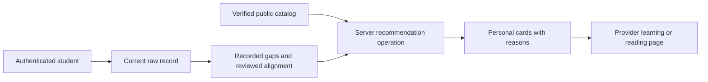

# Personalized courses and reading resources

Approved research and architecture baseline, checked 9 November 2026. The local-catalog feature was implemented and verified on 10 November 2026. The user rebuilt the local Docker application, and read-only artifact checks confirmed that its containers contain the feature. The design below records the baseline. The implementation and verification notes describe the delivered behavior.

## Recommended solution

Start with a small, verified local catalog of free courses, modules and e-books. Generate the recommendation list on the server from the current student's own course and recorded learning needs. Link to the provider's real learning page. A live search API is not required for a useful first version.

Add public-book discovery later only if students need to explore beyond that catalog. Keep discovery separate from trusted recommendations. A search result is not proof of free full-text access, appropriate prerequisites or PLO alignment.

This gives the FYP usable destinations without new API accounts, usage charges or a dependency on Redis, ML or external searches when opening the tab. It still requires curator time, existing hosting and periodic source review. It does not promise free vendor exams, commercial software, practical assessments or every provider's classroom sessions.

## Baseline before implementation

`src/components/dashboard/StudentDashboardClient.jsx:650` defines a hardcoded dictionary of course names for PLO 1 through 9. The selection at line 707 follows the single weakest-PLO label returned by the academic skill-gap endpoint. The courses tab at line 1422 displays that example plus an AWS card for every student.

Both Mula Belajar and Daftar Sesi lack a destination or handler. The four-hour label, AI badge, advanced AWS label and six-hour IKMB workshop description are frontend literals. The project has no course catalog, enrollment service, event schedule or learning-progress model to support those claims.

The existing import uses zero when a PLO has no recorded assessment. The normalizer also converts missing or invalid values to zero. Although the insight text calls zero unrecorded, the current minimum selection still uses it as the weakest PLO. New learning logic should read raw values and preserve unknown separately.

The current PLO labels also differ from the pasted blueprint. Existing code puts safety under PLO 3, innovation under PLO 5 and digital/technical content under PLO 6. These strings in `backend/items.js:780` are generic UI and chatbot guidance, not verified curricula for each IKMB program. Neither grouping should be presented as an official program-to-skill mapping without review.

## Free sources worth using

The following are verified source leads and proposed subject matches. They are not an approved IKMB syllabus. Provider pages were checked without creating accounts or completing enrollment. JavaScript, automated-access restrictions and regional access still need a normal-browser check before a final catalog is published.

| Audience | Source and concrete destination | Access and use |
|---|---|---|
| DFK | [Microsoft's cloud-computing introduction](https://learn.microsoft.com/en-us/training/modules/describe-cloud-compute/) | Beginner module with basic IT prerequisites. Microsoft says training content is free to read without a profile. Progress and credentials are separate. No fixed duration was reliably exposed in this research. |
| DFK | [Cisco Networking Basics](https://www.netacad.com/courses/networking-basics?courseLang=en-US) | Official listing advertises free beginner learning, 22 hours and labs. English is available. Registration and the JavaScript enrollment path need a normal-browser check. A learning badge is not CCNA certification. |
| DFK | [AWS Cloud Practitioner training](https://aws.amazon.com/training/learn-about/cloud-practitioner/) | Current introductory digital course is advertised free. The current provider listing says 12 hours 45 minutes, not the existing six-hour app label. Digital learning is separate from the AWS certification exam and classroom training. |
| ITW, with SLR relevance | [Basic Blueprint Reading, Open Oregon](https://openoregon.pressbooks.pub/blueprint/) | Written for first-year welding learners. Public reading and PDF/EPUB formats were observed. Some repeat automated requests returned 403. It supports print interpretation, not full welding qualification. |
| SLR | [Drafting and AutoCAD 2D, BCcampus](https://opentextbc.ca/autocad2d/) | Public web textbook with PDF/EPUB. Review software-version relevance. The free book does not grant AutoCAD software access; its license also excludes specified third-party material. |
| DCG and SED | [Electrical Fundamentals E-1, BCcampus](https://collection.bccampus.ca/textbook/Nf7jVbAg/) | Entry-level electrical theory with publisher PDF/EPUB links. International theory is useful supporting material, not a declaration of Malaysian wiring compliance or licensing. |
| DGA | [NGK/NTK TekniWiki](https://www.ngkntk.com/uk/service/tekniwiki/) | Manufacturer states its technical modules, videos and diagnostic material are free with no registration. A useful automotive-topic source. This is a provider portal, not a complete reviewed automotive textbook or IKMB qualification. |
| PPU | [Danfoss cooling learning](https://www.danfoss.com/en-gb/service-and-support/learning/cooling-learning/) | Dedicated refrigeration and HVAC learning. Self-paced online learning is free with an account. Exact program deep links should be checked; live or classroom training can have fees. |
| Any course, where relevant | [e-LATiH communication course](https://elatih.hrdcorp.gov.my/courses-details/7-ways-to-immediately-speak-better) | This particular listing is marked free and beginner, with a 1 hour 2 minute duration. Enrollment and language need final verification. e-LATiH also has premium content, so check each item rather than label the whole provider free. |
| Any course, where relevant | [Trades study skills](https://opentextbc.ca/tradescommoncoreb1/) and [workplace communication](https://opentextbc.ca/tradescommoncoreb3/) | Public trades-oriented reading with downloadable formats. Useful general resources rather than an unrelated vendor course. |

Additional reading candidates include [OpenStax computing foundations](https://openstax.org/books/introduction-computer-science/pages/preface) for DFK and [entrepreneurship](https://openstax.org/books/entrepreneurship/pages/preface) for an appropriate business-learning interest. Their current prefaces specify CC BY-NC-SA 4.0. Other books have different licenses and exceptions. Store per-resource license notes and link to the publisher instead of copying PDFs or covers by default.

[OpenLearn manufacturing](https://www.open.edu/openlearn/science-maths-technology/design-innovation/manufacturing/content-section-0) is a free introductory theory option for ITW or SLR after topic review. [OpenLearn electronics](https://www.open.edu/openlearn/science-maths-technology/an-introduction-electronics/content-section-0) is free but intermediate, so it must not be silently presented as beginner material. Course duration, prerequisite, language and completion recognition belong to the individual resource.

For Malaysian workplace and business topics, [HRD Corp's e-LATiH overview](https://hrdcorp.gov.my/) confirms that the platform has both free and premium courses. Use it for carefully selected local material. Do not infer Malay language, free certificates or outside-student eligibility from a platform name alone.

## Corrections to the proposed API stack

| Proposed integration | Current finding | Recommendation |
|---|---|---|
| Microsoft Learn keyless catalog | Official documentation says the older unauthenticated catalog begins deprecation after June 2026. The replacement remains free but requires authentication and onboarding. This does not prove the old endpoint has already stopped responding. | Link to selected Learn modules first. Do not base a new integration on a permanent keyless catalog assumption. |
| Google Books | Public requests require an API key or OAuth identifier. `free-ebooks` filtering exists, but access information and country restrictions still matter. | Optional later discovery. A preview or bibliographic record is not a free complete technical textbook. |
| Open Library | Public discovery is available, but records can be readable, borrow-only, preview-only or metadata-only. Default request rate is limited and caching is requested. | The simplest possible later book-discovery provider. Validate edition-level public reading and keep it separate from personalized recommendations. |
| YouTube Data API | Search has credential and quota requirements. | Begin with reviewed direct playlists or videos. An API is unnecessary merely to open an existing lesson. |
| Existing career Redis service | It owns paid JSearch protection, cooldowns and an 08:00 reset. It is not a general 24-hour learning-resource cache. | A local catalog needs no cache. Any later discovery service owns separate public-metadata keys and expiry. |

The API findings are supported by [Microsoft's current catalog documentation](https://learn.microsoft.com/en-us/training/support/integrations-learn-platform-api-catalog), [Microsoft's authentication reference](https://learn.microsoft.com/en-us/training/support/integrations-learn-platform-api-catalog-endpoints-developer-reference), [Google Books documentation](https://developers.google.com/books/docs/v1/using), [Open Library API guidance](https://openlibrary.org/developers/api), its [reading-access explanation](https://openlibrary.org/help/faq/reading), and [YouTube quota documentation](https://developers.google.com/youtube/data/determine_quota_cost).

## Personalization that the data can support

### Current student and privacy

Add `GET /api/courses/recommendations`, authenticated through the existing JWT proxy. The server takes the student identity from the session and obtains the current processed-dataset record. The browser cannot submit a different student, course, marks or risk label as trusted input. Historical academic selection does not redefine the current recommendation subject. Personalized responses use private/no-store HTTP headers.

Reuse the current raw student selector rather than invoke `getStudentSkillGapById`, which adds an unnecessary ML request and normalizes missing marks to zero. The existing `getCurrentCareerSubject` already returns the raw current record and seven-course scope. Reuse it unchanged initially. Its career-specific name is an accepted naming limitation, preferable to copying its membership query or expanding this feature into a general refactor.

The public catalog may contain a resource applicable to several courses. Electrical fundamentals can legitimately serve DCG and SED, and study skills can serve everyone. Personal reasons, marks and future progress remain student-owned. Public resource reuse does not expose another student's private history.

### Interpreting learning needs

Parse raw PLO values before ranking. Only finite numeric scores above zero through 100 count as recorded under the current import convention. Zero, blank, malformed and out-of-range values are unknown. Select at most the two lowest recorded scores below 80, with ascending PLO number as a stable tie-break.

Those numbers identify academic targets; they do not reveal their subject meaning. A resource can claim a PLO-specific reason only when the catalog includes a reviewed mapping for that exact program, PLO and topic. Candidate mappings remain inactive for such reasons. Select the two weakest recorded gaps before checking mappings. If one has no reviewed resources, use course foundations for that slot rather than quietly substituting a third gap and calling it one of the two weakest.

Without that mapping, return useful course foundations immediately and label them Berdasarkan kursus anda. Do not block all learning while the taxonomy is reviewed. If scores are missing, show a data-incomplete notice. If recorded scores meet the target, offer exploration or enrichment without inventing a weakness. Keep unknown assessments visible even when the recorded scores meet 80.

Do not use dropout risk as intelligence, difficulty preference or a reason to hide learning. Do not interpret Tiada as proof that a student has no qualification. Do not recommend AWS or CompTIA to every course because a certificate field is empty. CGPA and attendance have no validated resource-difficulty rule in this project.

### Ranking and exclusions

Publish only resources with a checked free-learning route, genuine destination and relevant audience. Keep paid, unknown-access, broken or pending entries outside the free recommendation list. Prefer introductory resources without specialist prerequisites for the initial guided list. Keep advanced options separate with their real prerequisites; semester or GPA cannot prove those prerequisites.

Order eligible resources by these reason classes:

1. Reviewed alignment to the student's first recorded learning gap.
2. Reviewed alignment to the second gap.
3. Current-course foundations.
4. General study or communication foundations.

Use a curator's teaching-sequence order and stable resource ID inside a class. Show a resource once even if it supports two gaps. Deduplicate identical destinations without merging distinct chapters or resources. Do not add points for provider popularity, peer clicks or a recently fetched record. Display reasons rather than a match percentage or unsupported AI badge.

Start with at most three courses/modules and three reading resources. Prefer one useful item per mapped gap and retain room for a course foundation. Show fewer cards when suitable resources are unavailable. This is a proposed interface limit, not measured learning dosage or a guarantee of six verified resources for every course.

## Example output

These examples explain the approved rules. The application ranker now implements them, but no official PLO mapping was established by this research. PLO-specific examples use hypothetical review fixtures only.

For a DFK student with PLO 2 at 55, PLO 1 at 68 and PLO 6 at zero, the zero does not win the weakest-score calculation. Until a DFK curriculum map is reviewed, the page can show:

| Resource | Reason | Action |
|---|---|---|
| Microsoft cloud-computing module | Course foundation for Komputasi Awan. No claim that PLO 2 means cloud computing. | Mula Belajar |
| OpenStax computing text | Supporting computing reading for DFK. | Baca e-buku |
| Trades study-skills text | Optional general study support. | Baca e-buku |

The page separately notes that PLO 6 has no recorded assessment and that detailed PLO-topic alignment is not yet reviewed.

An ITW student instead receives welding blueprint reading. Manufacturing theory remains a future candidate pending reliable access and topic review. An SLR student receives drafting resources. A DGA student can receive a clearly labeled automotive learning portal. The universal AWS card disappears.

Once a lecturer confirms that resource X supports DFK PLO 2 and resource Y supports DFK PLO 6, student A with recorded scores 55 and 64 receives X before Y. Student B with scores 76 and 48 receives Y before X. This hypothetical fixture explains true within-course personalization. It does not assert that the current generic PLO labels establish those resource mappings.

An example real-destination card would read:

> Describe cloud computing
>
> Microsoft Learn. Beginner. Free to read. Basic IT familiarity required.
>
> Berdasarkan kursus Komputasi Awan anda.
>
> Mula Belajar opens the provider's module. Achievements and credentials are separate.

Microsoft's [training FAQ](https://learn.microsoft.com/en-us/training/support/faq) distinguishes public reading from profile-based progress and credentials. No click in this project establishes enrollment, completion or certification.

## Actions and maintenance

Use Mula Belajar for a verified course/module destination and Baca e-buku for a publisher reading page. A provider landing page gets Buka portal pembelajaran, not an invented course title. Mark account-required resources before the click. Open ordinary HTTPS provider links in a new tab with appropriate rel attributes.

Remove Daftar Sesi from this first version. The app has no actual organizer, schedule, seat availability or booking URL. External enrollment stays on the provider's site. Do not add local progress tracking, account SSO, an embedded reader or completion claims solely to make these links work.

Store a checked date, free-access evidence, observed language, level, real duration when available, credential note and license information per item. Record whether evidence is a provider listing or tested public reading. Neither means account enrollment was completed. A known-free account course can show its provider-listed status and registration notice; an uncertain eligibility or checkout path stays pending. Unknown duration or language stays unknown. Do not label an entire provider free, all books downloadable or all certificates included. Do not rehost course files or copy covers by default.

Review source links, price, access and content before release and periodically afterward. A link checker can flag failures, but HTTP 200 cannot prove that a course is still free or a curriculum match. Disable changed or unusable entries through the registry. A stale checked date is a reason to review, not proof the item became paid. Learning materials do not inherit the job cache's daily reset or 30-day advertisement rule.

## Proposed usage and structure

The caller uses one recommendation operation. The UI does not fetch each provider, interpret PLO definitions or coordinate ranking stages.

```js
// Existing authentication supplies the subject.
const list = await recommendLearningForStudent(req.user.studentId);
res.set('Cache-Control', 'private, no-store').json({ success: true, ...list });

// The existing Next proxy forwards the session.
const response = await fetch('/api/courses/recommendations', { cache: 'no-store' });
const listForDisplay = await response.json();

/**
 * @typedef {'ITW'|'DFK'|'DGA'|'SLR'|'DCG'|'SED'|'PPU'} Department
 * @typedef {1|2|3|4|5|6|7|8|9} PloIndex
 * @typedef {{kind:'known',score:number}|{kind:'unknown'}} Assessment
 * @typedef {{kind:'free-open'}|{kind:'free-account',note:string}} LearningAccess
 * @typedef {{status:'active',checkedAt:string,evidenceUrl:string,
 *   evidenceKind:'provider-listed'|'public-reading-tested',access:LearningAccess}|
 *   {status:'pending'|'disabled',reason:string}} Publication
 * @typedef {{kind:'general'}|{kind:'program',departments:Department[]}} Audience
 * @typedef {{id:string,title:string,provider:string,url:string,
 *   kind:'course'|'module'|'ebook'|'provider-catalog',audience:Audience,
 *   topics:string[],level:'introductory'|'intermediate'|'advanced'|'unknown',
 *   languages:string[],durationMinutes:number|null,prerequisites:string[],
 *   publication:Publication,credentialNote:string,
 *   license:{label:string,url:string|null}|null,editorialOrder:number}} LearningResource
 * @typedef {{status:'candidate',department:Department,plo:PloIndex,topics:string[]}|
 *   {status:'reviewed',department:Department,plo:PloIndex,topics:string[],
 *   reviewedAt:string,evidenceRef:string}} CurriculumAlignment
 * @typedef {{version:string,resources:LearningResource[],alignments:CurriculumAlignment[]}} LearningCatalog
 * @typedef {{resource:LearningResource,reasons:string[],action:{label:string,url:string},
 *   notes:string[]}} LearningRecommendation
 * @typedef {{department:Department,dataset:string,catalogVersion:string,
 *   mode:'reviewed-gaps'|'course-foundations'|'enrichment',
 *   courses:LearningRecommendation[],ebooks:LearningRecommendation[],
 *   notices:string[],emptyReason:null|'catalog-coverage-gap'}} LearningRecommendations
 */
```

The data shapes keep publication/access and curriculum-review evidence separate, following Model the Domain. The public operation hides subject selection, parsing, course filtering, ordering and explanation generation. This records the approved contract. The implemented operation is in `backend/services/courseRecommendation.service.js`.

| Module | Ownership |
|---|---|
| `backend/data/learningCatalog.js` | One catalog of public resources, all seven program scopes, publication status and reviewed topic/PLO mappings. No browser copy of the same rules. |
| `backend/services/courseRecommendation.service.js` | One current-student recommendation operation and private policy functions. No runtime provider, Redis or ML calls. |
| `backend/courses.js` | Student-role/JWT checks, unsupported-query refusal, private responses and HTTP error mapping. |
| Existing `backend/server.js` | Mount the courses router under `/api/courses`. |
| Existing current-subject helper | Reuse its current-record policy. Keep academic historical lookup separate and do not duplicate authorization queries. |
| `src/components/LearningRecommendations.jsx` | Cards, server reasons, honest access labels, error/coverage states and protection against delayed replies for an old account/course. |
| Existing `StudentDashboardClient.jsx` | Replace the hardcoded learning dictionary and two-card view with the component. Other dashboard features retain their existing ownership. |



## Design comparison and synthesis

Two independent sketches considered a curated-only catalog and a curated system with separate on-demand Open Library discovery. Both concluded that a local catalog is sufficient for the initial useful experience. A separate design review agreed and required the explicit partial-mapping and access-evidence distinctions above. The available model was inherited for the sketches and review; this is independent design exploration, not a claim of model diversity.

Choose the curated design as the base. It has the smaller interface and failure boundary, and it directly addresses the absent catalog and real-link problem. Retain the hybrid's explicit future separation between public discovery and trusted personalized recommendations. Reject request-time calls to five APIs, automatic promotion of book hits into PLO matches, a new admin CMS, an LLM ranking layer and a learning-progress system for this first scope. This follows Laziness Protocol.

The tradeoffs are manual catalog maintenance, limited initial breadth and honest course-only recommendations until reviewed PLO mappings exist. These are preferable to presenting uncertain API metadata as personalized educational advice. API discovery improves breadth, not the missing curriculum evidence.

If later needed, add an explicit Cari bahan tambahan action backed by one public discovery service. Cache only provider/topic/language metadata in a separate namespace for a proposed 24 hours, respect provider limits and mark observed access. Send no names, IDs, marks, risk or personalized descriptions. Borrow-only, preview-only and unknown records never receive a free-full-reading label. Provider failure must leave the curated cards intact. This optional module is not part of the recommended first release.

## Verification requirements

Validate every catalog entry for unique identity, genuine HTTPS destination, known audience/topic codes, access evidence, checked date and honest action. Review per-resource price and curriculum suitability independently from syntax or HTTP status.

Behaviour fixtures should cover all seven course codes, technical cross-course exclusion, shared general resources, raw zero/missing/invalid PLO values, stable two-gap selection, reviewed versus candidate mappings, no assessed scores, no deficits, empty coverage, duplicates and pending/paid/broken entries. Assert literal opposite X/Y and Y/X orders for the hypothetical reviewed-map students. Do not claim a test proves an official syllabus or an enrollment path.

Authenticated HTTP checks should reject supplied student/course/grade overrides and previous-course access. UI checks should verify real link actions, account-required notes, unknown durations, unavailable versus empty states, current-course response checks and delayed old-account replies. The base recommendation list must still work with Redis, ML and provider access disabled.

## Implemented scope and verified assumptions — 10 November 2026

The local catalog, service, Express route and learning component are implemented. The old hardcoded PLO dictionary, universal AWS card, fictional durations and inactive booking control have been removed from this tab. No dependencies, environment settings, database schemas, live discovery calls, Redis keys, ML requests or progress tracking were added.

The source check confirmed zero-valued unrecorded MDB assessments and the existing `0 < score < 80` pathway gap rule. It also found two important contradictions: the old academic weakest-PLO selector still includes zero, and no reviewed institutional program/PLO/topic taxonomy exists. Those findings were reported before implementation. Learning recommendations parse raw assessments independently and ship an empty `alignments` list, using course foundations with explicit notices. They do not change the older academic insight subsystem. The current-record helper is reused unchanged and rejects old-only membership.

### Shipped catalog and access evidence

The catalog contains ten resource records. Nine introductory resources or provider portals can enter the guided list; intermediate heat-pump reading remains excluded. All seven course codes have relevant technical material, and general reading may appear across courses. Some programs have reading resources rather than a course/module; the UI shows the available format and does not pad an empty course section.

- DFK: Microsoft cloud-computing introduction and OpenStax computing foundations.
- ITW and SLR: [Basic Blueprint Reading on LibreTexts](https://workforce.libretexts.org/Bookshelves/Manufacturing/Basic_Blueprint_Reading_(Costin)). The original Open Oregon URL intermittently blocked automated access; the licensed mirror exposes source attribution and reading.
- SLR: BCcampus drafting and AutoCAD 2D.
- DCG and SED: BCcampus Electrical Fundamentals E-1. Evidence is labeled provider-listed because this audit inspected the listing and download links, not the complete PDF.
- DGA: NGK/NTK TekniWiki, labeled as a provider portal with unknown level/language rather than an invented course.
- PPU: [Coalinga College's introductory HVAC page on LibreTexts](https://workforce.libretexts.org/Courses/Coalinga_College/Introduction_to_Residential_HVAC_Level_1/01%3A_Fundamentals_of_Heating_Ventilation_Air_Conditioning_and_Refrigeration_(HVAC_R)/1.01%3A_What_is_HVAC). Danfoss and OpenLearn remain research leads because their proposed destinations could not be verified reliably with the available automated client.
- General: BCcampus trades study skills and interpersonal communication reading.

Cisco, AWS, e-LATiH, entrepreneurship and live public-book discovery remain outside this initial catalog. Inclusion of an official source lead above does not mean it shipped. Catalog metadata distinguishes provider-listed evidence from tested public reading, records licenses without rehosting content and leaves unsupported duration/language values unknown.

### Verification performed

| Check | Observed result |
|---|---|
| Backend Jest suite | 47 passing tests across five suites; 15 new learning cases. |
| Frontend Vitest suite | 40 passing tests across five files; nine new component cases and one dashboard learning-tab integration case. |
| Isolated real Express/JWT/MongoDB script | Passed all seven course audiences, current membership over older snapshots, old-only refusal, zero/missing/invalid PLOs, exact 80, forged query rejection and unauthenticated/staff refusal. Personalized responses expose no student names or identifiers. |
| External-service independence | The integration script used unreachable Redis/ML endpoints and blocked provider fetches. Recommendations still passed without external calls. |
| Next production build | Passed with three existing router-effect dependency warnings. No new suppression was added. |
| Independent source review | Backend and frontend review found no actionable defects. |
| Resource destinations | All ten returned HTTP 200 and expected page titles across direct GET checks. The Node checker received bot challenges on four BCcampus URLs; a second client retrieved those same pages successfully. |
| Pre-commit repeat | All 40 frontend tests, 47 backend tests, the production build and isolated HTTP checks passed again. Repository hygiene and whitespace checks passed without unrelated file changes or credential findings. The Node link audit again exited with status 1 for four challenge pages. |
| Rebuilt local Docker artifacts | Running backend learning source matches the workspace. The frontend bundle includes the endpoint and its anonymous proxy request returns 401. This does not prove successful browser authentication or page layout. |

HTTP success does not establish normal-browser behavior, course enrollment, every linked exercise, current checkout terms or complete PDF access. No browser surface was available during implementation verification, and no provider account was created. The isolated test database and temporary MongoDB container were removed after the checks. No real academic records were changed. The user rebuilt the local application between implementation and commit preparation. The documentation and commit pass used read-only deployed-artifact checks and did not restart either application stack.

### Repeat the checks

From the project root:

```bash
npm test -- --run
npm --prefix backend test -- --runInBand
npm run build
LEARNING_TEST_MONGO_URI=mongodb://127.0.0.1:27017 node backend/scripts/verify-learning-recommendations.mjs
node backend/scripts/check-learning-links.mjs
```

Use a disposable MongoDB server for the HTTP script. It creates a unique `learning_recommendations_test_<uuid>` database, checks its name and drops that database in cleanup. It does not need Redis or ML. The link checker deliberately reports non-success responses and may need a manual provider-page review when automated access is challenged; keep it separate from deterministic unit tests and CI.

To maintain the feature, edit `backend/data/learningCatalog.js`, review each source's audience/access/license information and change publication status when an item becomes unsuitable. Only add `status: "reviewed"` curriculum alignments with evidence for the exact program, PLO and topic. Rerun the learning tests and link review after catalog changes. No institution-approved PLO mapping is implied by the hypothetical X/Y test fixtures.
